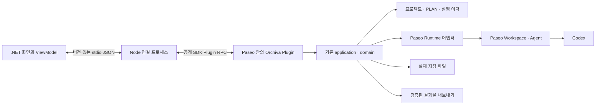
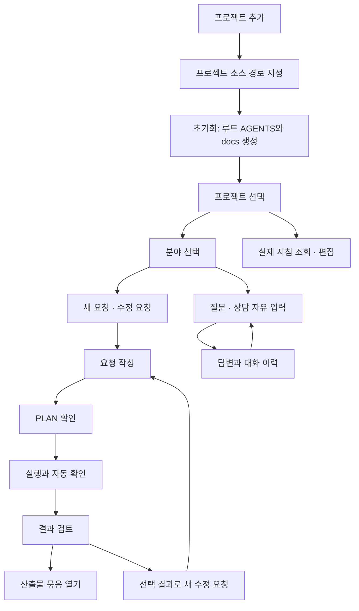

# Orchiva 데스크톱 전환 설계안

작성일: 2026-11-16 · Asia/Seoul
상태: 2026-11-16 D1~D3 구현·비GUI·[GUI 검증](../decisions/desktop-d1-d3-gui-20261116.md)을 완료했다. D4는 사용자 승인에 따라 접근 권한·승인 정책을 선택하는 자유 대화로 구현·검증을 완료했으며 최신 계약과 제약은 [D4 결과](../decisions/desktop-d4-conversation.md)를 따른다. 아래 초기 제안·비교는 이력이며 최신 계약이 우선한다. WinUI 3 + .NET 10, SDK 10.0.401/Windows App SDK 2.6.5, stdio/공개 SDK 연결과 제작 소스 반영 B안을 채택했다. D5 미디어 제작과 D6 배포는 미착수다.

제품 방향의 원본은 [데스크톱 인계](desktop-handoff.md), 기존 구현 기준은 [MVP 설계](mvp-design.md)다. 이 문서는 `b08dc13`의 소스와 [현재 PC 점검](../decisions/desktop-readiness-20261116.md)을 바탕으로 후속 구성을 제안한다. 개발 순서·검증·완료 기준은 [전환 계획](../plans/desktop-transition.md)에서 관리한다.

## 합의와 선택 상태

| 구분 | 내용 |
| --- | --- |
| 확정 방향 | Windows .NET exe, 기존 Node 실행 로직·Paseo 연결, 프로젝트 중심의 6개 분야, 제작의 새 요청/수정 요청, 자유 질문, PLAN 단위, 소스/결과물 분리, 실제 지침 편집, 자동 확인과 간단한 검토. 세부 요구는 인계 문서가 원본 |
| 이번 대화의 사용자 선택 | 초기 보류 후 **WinUI 3 + .NET 10**, **B안: 앱에서 변경 비교·파일 선택 후 소스 반영**으로 결정. 디자인도 첫 구현부터 포함. 프로젝트 소스마다 docs/를 필수로 두고 지침·PLAN·결정/작업 이력 관리 |
| D1 기술 채택 | stdio Node 연결 계층에서 기존 Plugin RPC 사용, Plugin의 단일 저장·실행 소유권 유지 |
| 추가 확정 | 제작 PLAN은 정형 입력 → AI의 템플릿 내 내용 작성 → 사용자 확인. 닫기 버튼은 설정에 따라 앱 종료 또는 트레이 최소화 |
| 아직 선택 전 | 최종 배포 형식, 앱 종료 시 진행 제작 작업 처리, Git 없는 폴더 제작 지원. 상담 PLAN 자동 완성은 향후 아이디어로 구현 제외 |
| 아직 구현으로 간주하지 않는 것 | D5 미디어 분야 제작, D6 배포. 다중 프로젝트·지침·기획/코딩 제작·간소 검토는 D2~D3, 자유 대화는 D4에서 구현. D1~D3 GUI G01~G11 완료 |

뒤의 구체적인 데이터 구조·동작은 초기 **후속 설계**다. D2~D3에서 채택·보완한 실제 경로·계약·제한은 위 완료 기록을 따른다. 현재 구현 사실로 읽지 않는다. D1 닫기 기본값은 앱 종료이며 daemon 수명은 분리했다. PLAN은 사용자에게 보이는 작업 단위이며 기존 Request PLAN/Task PLAN 두 원문과 내부 TASK를 즉시 없애지는 않는다.

## 재사용 범위와 변경 지점

| 책임 | 현재 코드·검증 근거 | 후속 변경 |
| --- | --- | --- |
| 초안·계획 확인 | [draft-request](../../server/application/draft-request.ts), [request-plan](../../server/domain/request-plan.ts), [M2](../decisions/m2-draft-plan-start.md): 입력 해시·계획 revision·고정 SHA | 분야별 양식, 지침 snapshot, 모델·수준, 결과물 위치와 입력 원본을 PLAN에 포함. 현재 PLAN은 템플릿이며 LLM 계획 생성기가 아님 |
| 실행·중복 방지 | [start-feature-request](../../server/application/start-feature-request.ts), [execution-slot](../../server/application/execution-slot.ts), [M1](../decisions/m1-storage-state.md) | 동일 명령키·payload·revision과 의도 선저장 유지. 프로젝트를 늘려도 전체 활성 작업 1개 유지 |
| 관측·복원 | [reconcile](../../server/application/reconcile.ts), [service](../../server/adapters/paseo/service.ts), [M3](../decisions/m3-progress-reconciliation.md) | Plugin이 계속 단일 루프 소유. 프로젝트마다 UI에서 루프를 만들지 않음 |
| 실패 복구 | [recover-request](../../server/application/recover-request.ts), [track-execution](../../server/application/track-execution.ts), [M5](../decisions/m5-recovery.md) | 초기 재시도·재검증·동일 세션 재개·전달 대조를 분리. 제품의 수정 요청과 장애 복구를 다른 계약으로 표현 |
| 저장 | [json-request-store](../../server/adapters/storage/json-request-store.ts), [directory-owner](../../server/adapters/storage/directory-owner.ts) | 임시 파일·sync·rename·소유권·불변 이력을 재사용. 프로젝트 식별자·신규 스키마·가져오기 절차 필요 |
| 결과·판정 | [evidence](../../server/adapters/storage/evidence.ts), [review](../../server/domain/review.ts), [M4](../decisions/m4-evidence-review.md) | 현재 Git 변경/미추적 파일·2 MiB/300개 한도와 Node/문자열 검사에 한정. 큰 미디어·ignored 산출물·외부 결과물 묶음은 새 수집기 필요 |
| Paseo 연결 | [connection](../../server/adapters/paseo/connection.ts), [runtime](../../server/adapters/paseo/runtime.ts), [M0](../decisions/m0-runtime-foundation.md) | 공개 SDK·재접속·ID 대조 재사용. 고정 home/endpoint, sandbox 전용 프롬프트·경로 검사에 설정 주입 필요 |
| 설정 | [project-config](../../server/config/project-config.ts) | 현재 `PoC Sandbox`, 홈 아래 `lib/orchiva-PoC`, PoC remote를 강제. 임의 게임 경로를 기존 설정에 넣는 방식으로 전환하지 않음 |
| UI/RPC | [index.server](../../index.server.ts), [index.client](../../index.client.tsx), [계약](../../shared/contracts/feature-request.ts) | TypeScript 계층은 재사용하되 React Native 화면은 C# 화면으로 다시 작성. Zod/defineRpc를 C#이 직접 사용할 수 있다고 가정하지 않음 |
| 모델·수준 | 현재 Runtime은 `config.provider`만 전송 | 설치 SDK 0.15.4의 `providers.listModels`, 모델 `thinkingOptions`, `PaseoAgentConfig.thinkingOptionId`는 타입상 존재. 실제 모델별 지원은 다음 실연동에서 조회·확인 |

[M6](../decisions/m6-acceptance.md)의 89개 테스트·수용·장애 결과는 기존 브라우저 MVP의 근거다. 이번 PC에서도 자동 테스트 89개는 통과했으나 새로운 desktop 통신·프로세스·배포가 검증된 것은 아니다.

## 개발 환경과 UI 비교

권장 계열은 C#·.NET 10 LTS다. 공식 정책상 .NET 10은 2028-11-14까지 지원되며, 새 major가 나왔다는 이유만으로 전환하지 않는다. 설치 SDK `10.0.401`과 조회일의 권장 패치 후보 `10.0.404`를 구분하고, 착수 시 지원 패치와 IDE 호환성을 다시 확인해 `global.json`과 NuGet lockfile에 고정한다. [공식 지원 정책](https://dotnet.microsoft.com/en-us/platform/support/policy), [공식 다운로드](https://dotnet.microsoft.com/en-us/download/dotnet/10.0).

| 후보 | 장점 | 추가 부담·판단 |
| --- | --- | --- |
| WPF + .NET 10 | Windows 전용, XAML·바인딩·문서/목록/편집 UI와 맞음. 현재 PC에 WindowsDesktop pack·템플릿 존재 | 초기 추천안이었으나 채택하지 않음. 비교 이력으로 보존 |
| WinUI 3 + .NET 10 | Fluent 스타일과 최신 Windows 경험. Microsoft가 신규 Windows 앱에 권장하는 네이티브 UI | **사용자 선택으로 채택**. Windows App SDK와 배포 구성을 함께 선택해야 함. 현재 WinUI workload·winapp 도구 미검출 |

WPF의 Windows 전용·바인딩 기능과 WinUI의 Fluent/Windows App SDK 기반은 공식 문서에서 확인했다. 초기 WPF 추천 이후 사용자가 디자인을 처음부터 챙기는 방향으로 WinUI 3를 선택했으므로 이후 UI 구현 기준은 WinUI 3다. [WPF 개요](https://learn.microsoft.com/en-us/dotnet/desktop/wpf/overview/), [WinUI 3 개요](https://learn.microsoft.com/en-us/windows/apps/winui/winui3/).

WinUI 3에서 화면 상태 바인딩과 .NET 연결 라이브러리를 분리한다. D1은 명시적 NuGet 참조와 SDK 프로젝트로 CLI build를 구성했으며 VS workload나 winapp 전역 설치 없이 빌드를 확인했다. 초기 조사 당시의 설치 미실행 기록은 준비 기록에 보존한다. 후속 개발 환경 확대는 [WinUI 환경 안내](https://learn.microsoft.com/en-us/windows/apps/get-started/start-here)를 확인한다.

디자인은 D1부터 수행한다. Fluent 구성요소를 바탕으로 색상·글꼴 계층·간격·모서리·아이콘·상태 표현을 공통 리소스로 정의하고 프로젝트 탐색·본문·진행/결과 영역의 배치를 설계한다. 밝은/어두운 테마, DPI, 키보드 포커스, 대비, 긴 한국어 텍스트와 창 크기 변화도 함께 확인한다. 첫 조회 화면의 빈 상태·로딩·오류·연결 끊김까지 같은 시각 규칙을 적용한다. 구체적인 색상과 시안은 D1 산출물로 검토하며 기능 구현 뒤로 일괄 미루지 않는다.

## 연결 방식과 책임

### D1에서 채택한 연결 구성



.NET은 UI·연결 자식 프로세스·사용자 진입점을 담당하고, Node 연결 프로세스는 요청 변환과 SDK 연결만 담당한다. 상태 전이·검증·저장·복구는 현재 Plugin의 application/domain에 남긴다. 현재 [verify 스크립트](../../scripts/verify.mjs)도 공개 `createHostClient`와 `invokePluginRpc`로 Plugin을 호출한다. 이 경로를 .NET stdio 연결 계층에서 재사용하도록 구현했다.

| 통신 대안 | 비교 |
| --- | --- |
| **stdio JSON + Node SDK 연결 계층 (추천)** | 별도 inbound 포트 불필요, 자식 수명과 입출력 소유가 명확. 기존 SDK를 그대로 사용. 프레임 한도·비동기 읽기·재연결 계약을 새로 구현해야 함 |
| Windows named pipe 서비스 | UI가 재접속 가능한 독립 서비스에 적합. ACL·발견·소유권·서비스 수명 추가 필요. 현재 저장소의 named pipe는 잠금용이며 RPC 채널이 아님 |
| loopback HTTP/WebSocket 서비스 | 다중 클라이언트와 진단에 편리. 포트·인증·요청 출처 검증·독립 서비스 소유가 추가됨 |
| C#에서 Paseo wire protocol 직접 구현 | Node 연결 자식은 줄지만 SDK 프로토콜·인증·호환 대응을 C#에서 중복 유지. 1차 추천 대상에서 제외 |

프로토콜은 UTF-8 한 줄 JSON의 요청/응답 envelope를 제안한다. 필드 예시는 `protocolVersion`, `id`, `method`, `params`, 응답의 `result` 또는 `error { code, message, retryable }`다. `id`는 통신 상관 ID이고 실행 중복을 막는 `commandKey`와 다르다. handshake는 앱/bridge/SDK/서버 계약 버전과 capability를 반환한다. 호환되지 않는 major는 실행을 차단한다.

stdout은 프로토콜 전용, stderr는 비밀값을 제거한 한도 있는 로그로 사용한다. UI가 두 스트림을 동시에 비동기로 소비하고, 프레임 크기·대기시간·동시 요청 수를 제한한다. 초기 제안 한도는 프레임 1 MiB, 조회 timeout 15초다. 큰 이력·로그는 후속 페이지/부분 조회 계약으로 나누며 한도 초과를 성공으로 잘라 반환하지 않는다.

bridge는 허용된 메서드와 Zod 스키마를 검사하고 SDK RPC에 전달한다. C# DTO는 같은 wire schema와 공용 fixture로 호환성을 검증한다. `ready` handshake가 나오기 전에는 제품 명령을 보내지 않는다. 첫 단계에서는 조회만 허용하고 `request.refresh`·재검증·시작·재개·판정은 열지 않는다. 일반 조회에도 v1 저장소 첫 로드의 migration이 있을 수 있으므로 격리한 v2 데이터로 먼저 시험한다.

나중에 실행 명령이 열리면 UI는 전송 전에 token·commandKey·payload 식별 정보를 UI 전용 미확정 전송 journal에 저장한다. 이것은 요청 저장소가 아니라 원래 명령을 찾기 위한 보조 기록이다. 서버의 durable intent가 실행 원본이다. 응답 유실 후 같은 요청·명령을 조회하고, 같은 키 replay만 사용하며 새 키를 자동 발급하지 않는다. 전달 취소·UI timeout을 서버 작업 취소나 실패로 해석하지 않는다.

### 프로세스 시작·종료·복원

| 상황 | 추천 동작과 소유권 |
| --- | --- |
| 앱 시작 | 앱 설치 위치에서 실행 파일·인수를 탐색. PATH 결과를 그대로 신뢰하지 않고 버전·실경로 확인. child 환경에만 dataHome/paseoHome/endpoint를 전달 |
| 기존 daemon 발견 | home·endpoint·프로세스 정체성·Plugin 버전을 검사하고 연결. 불일치하면 진단하며 무관한 daemon을 종료하지 않음 |
| daemon 중지 | 등록된 전용 home만 시작. 숨김 프로세스와 인수 배열 사용. 현재 start script의 자식 환경 두 변수 조정 범위 유지. 사용자 전역 설정·Codex sandbox/승인 정책 변경 없음 |
| 준비 | bridge handshake → Plugin 저장소 소유권·복원 완료 → 명령 허용. 시작 시간 초과는 연결 실패로 안내하고 원래 작업 조회 가능성을 보존 |
| 창 닫기 | 사용자 설정에서 **앱 종료 / 트레이 최소화** 선택 가능하게 설계하는 것으로 확정. 트레이 선택은 창을 숨기고 복원 경로를 제공하며 앱 종료와 구분. 설정 기본값과 앱 종료 시 진행 작업 처리 정책은 미정. 앱 종료와 실행 작업 중단을 같은 명령으로 간주하지 않음 |
| 전체 종료 | 별도 명령. 모든 프로젝트의 활성/unknown 작업을 먼저 확인. busy이면 종료를 보류하고 작업 상태로 이동. 명시적인 작업 중단은 별도 기능으로 설계 |
| 정상 종료 | 신규 명령 접수 중단 → 구독·타이머 종료 → 진행 cycle/쓰기 drain → store 소유권 해제. bridge 종료로 daemon이나 Agent를 process-tree kill하지 않음 |
| UI/bridge crash | Plugin 작업은 계속. 새 bridge로 저장 상태 재조회. UI 미응답을 근거로 새 Agent·Worktree 생성 금지 |
| daemon/Plugin crash | 기존 의도·ID·결과에서 복원. accepted/plans의 확실한 checkpoint만 계속; 생성·전송 중단은 unknown 유지 후 대조 |
| OS 종료/다른 PC | 계속 실행을 보장하지 않음. 같은 PC 재시작 때 대조하고, 다른 PC의 JSON만으로 세션·Worktree가 복원된다고 표시하지 않음 |

UI에는 연결됨·복원 중·입력 대기·전달 미확정·실행 실패를 구분한다. Plugin의 기존 5초 관측·backoff를 재사용하고 bridge의 화면 조회 주기는 실행 worker를 만들지 않는다. 로그에는 인증 token·환경 전체·요청 원문을 출력하지 않는다.

## 프로젝트·PLAN·저장 구조

### 소유권과 경로

Node application이 프로젝트 설정·요청·PLAN·검사·결과·판정·지침 편집·내보내기를 소유한다. .NET은 RPC로 이를 요청하고 UI 표시 설정·미저장 입력·전송 journal만 별도 저장한다. Paseo는 세션·Workspace·Worktree·provider 인증을 소유한다. .NET과 Node가 동일 요청 JSON에 쓰지 않는다.

**프로젝트 소스와 지침의 권위 원본은 등록한 실제 경로의 파일이다.** 앱은 파일을 필요할 때 읽고 외부 편집도 재조회·해시 대조로 반영한다. 앱 내부 DB로 프로젝트 전체를 가져와 그 사본만 관리하는 방식은 아니다. 경로 등록은 파일 이동이나 가져오기가 아니다. 프로젝트 docs/에는 설정과 요청/PLAN/실행 이력·파일 해시를 저장하고, 재현·비교·복구에 필요한 입력 snapshot·Worktree·적용 전 백업만 별도로 보관한다. 이 사본은 현재 원본 파일을 대신하지 않는다.

계획의 Git 기준 SHA와 사용자가 보고 있는 작업 폴더 파일도 구분한다. 미커밋 변경이 있는 입력은 원본 bytes·해시를 기록해 승인한 작업 공간 입력에 반영하거나, 지원하지 못하는 범위를 명시하고 준비를 보류한다. 조용히 HEAD 버전으로 바꾸거나 사용자 파일을 commit/reset하지 않는다. 결과 적용 직전에는 앱의 캐시 대신 실제 원본을 다시 읽는다.

프로젝트별 docs/ 관리는 사용자 확정 사항이다. 적용 대상은 **Orchiva 앱에 추가하는 각 프로젝트의 소스 루트**이며 Orchiva 개발 저장소의 지침 구조와 구분한다. 아래 파일은 초기화 기능의 생성 대상이며 기능 구현은 **예정**이다. 이번에 운영 프로젝트에는 생성하지 않는다. 초기 설계의 사용자 홈 중앙 보관안을 대체한다.

```text
<sourceRoot>/
  AGENTS.md                         docs/ 지침과 작업 흐름을 연결하는 진입점
  docs/
    agents/                         공통·분야별 실제 지침
    plans/                          PLAN 원문·revision·진행/검증 기록
      plans.md                      계획 작성·상태 규칙
      README.md                     계획 목록·현재 상태
    decisions/                      결정·결과·실패/복구 기록
      decisions.md                  결정 기록 규칙
    evidence/
      evidence.md                   검증 근거 보관 규칙
      <플랜 이름>/<실행 ID>/        플랜별 검증 결과·로그·화면
    .orchiva/                       내부 기록의 세부 배치는 구현 때 확정
      project.json                  프로젝트 ID·설정·상대 지침 경로
      requests/<token>.json          명령·시도·결과·판정의 구조화 이력
      snapshots/<sha256>.json        고정 입력·지침 근거
      backups/                      편집·적용 전 백업
<outputRoot>/<PLAN ID>/<resultId>/   요청한 산출물 묶음과 원래 상대 경로
%USERPROFILE%/.orchiva/requests/     기존 v2 원본, 명시적 이관 전 보존
```

앱에는 최근 프로젝트 경로·이 PC의 절대 경로 연결·UI 설정·재생성 가능한 캐시만 둔다. UI 전송 journal은 임시 복구 보조이며 확정된 명령·결과 이력은 프로젝트 docs/가 원본이다. Paseo 세션·실행 Worktree·인증 자료는 로컬 실행부 소유다. 프로젝트 폴더를 다시 등록하면 docs/ 이력을 읽어 화면을 복원하되 다른 PC의 Agent까지 자동 복원됐다고 표시하지 않는다.

프로젝트 추가 → 프로젝트 소스 경로 지정 → 초기화 실행 순서로 진행한다. 경로 지정 단계는 기존 파일을 읽어 준비 상태만 표시하며 프로젝트 파일을 생성하지 않는다. 사용자가 초기화를 실행하면 소스 루트에 AGENTS.md, docs/ 디렉터리와 아래 필수 지침·목록을 자동 생성한다. 기존 docs/ 구조와 AGENTS를 먼저 읽고 보존한다. 없는 docs/agents·plans·decisions·evidence와 역할별 지침·계획 목록 골격만 만들고 기존 파일을 통째로 덮지 않는다. 다른 기존 문서 경로는 연결로 재사용한다. AGENTS.md는 루트에 하나만 두고 docs/agents/의 공통 지침과 docs/plans/plans.md·docs/decisions/decisions.md·docs/evidence/evidence.md의 경로와 적용 조건을 연결한다. 별도의 docs.md 지도는 만들지 않는다. 기존 하위 AGENTS가 있으면 내용·링크·적용 범위를 보존해 역할별 이름으로 이관하고 이름 충돌은 덮어쓰지 않는다. 쓰기 권한이 없으면 부족 항목을 안내하고 준비 상태로 남긴다. 이 초기화 문서는 사용자가 요청한 관리 구조이며, 결과물 폴더에 요청하지 않은 README를 만드는 동작과 구분한다.

### 대상 프로젝트 초기화 계약

이 절은 앱의 제품 동작 설계다. Orchiva 자체 개발에 적용하는 AGENTS.md·docs/AGENTS.md·docs/plans/AGENTS.md와 공통 지침은 기존 규칙을 유지한다.

1. **프로젝트 추가**에서 이름과 실제 소스 폴더를 지정한다. 등록·탐색만으로 소스 파일을 만들거나 수정하지 않는다.
2. **초기화** 화면에서 선택한 소스 루트와 생성 예정·기존·충돌 항목을 보여준다. 사용자가 초기화를 실행하면 누락된 디렉터리와 아래 파일을 자동 생성한다. 결과물 경로 설정은 별도로 제공하며, 지침 초기화를 위한 필수 입력으로 요구하지 않는다. 제작 실행 전에는 결과물 경로를 검증한다.
3. 기존 AGENTS·지침 내용은 보존하고 필요한 연결만 검토 가능한 변경으로 제시한다. 하위 AGENTS 이관은 기존 내용·링크·적용 범위를 확인해 별도로 처리하며 무조건 이름을 바꾸거나 삭제하지 않는다. 충돌 미해결 상태는 준비 완료로 표시하지 않는다.
4. 중복 클릭·재초기화는 기존 파일과 프로젝트 ID를 보존하고 누락 항목만 보완한다. 쓰기 실패·중단은 생성 항목과 미완료 항목을 기록하고 다시 시도할 수 있게 한다. 기존 파일은 실패 정리 대상으로 삭제하지 않는다.
5. 모든 필수 파일과 루트 지도 연결을 다시 읽어 검증한 뒤 초기화 완료로 표시한다. 이는 실행 도구·인증·결과물 경로까지 준비됐다는 뜻은 아니다. 프로젝트 재등록은 기존 문서와 이력을 읽어 재사용한다.

| 초기화 생성 대상 | 내용 |
| --- | --- |
| 소스 루트 AGENTS.md | 유일한 지침 진입점. 아래 역할별 지침의 상대 경로·적용 범위 연결. 별도 docs.md나 하위 AGENTS는 신규 생성하지 않음 |
| docs/agents/의 공통 지침 | 작업 흐름·파일 명명·결과물 관리·지침 적용의 기본 규칙. 세부 파일명과 분야별 템플릿은 구현 때 확정 |
| docs/plans/plans.md | PLAN 작성·상태·revision·완료 조건·검증 기록 규칙. 실제 계획 문서를 원본으로 관리 |
| docs/plans/README.md | 비어 있는 계획 목록과 상태 관리 형식. 초기화만으로 가짜 PLAN이나 완료 이력을 만들지 않음 |
| docs/decisions/decisions.md | 맥락·대안·결정·근거·영향·후속 작업 기록, 변경된 결정과 이전 결과 보존, PLAN과 근거 연결 |
| docs/evidence/evidence.md | 플랜 작업 종료 시 evidence/<플랜 파일명 stem>/<실행 ID>/에 검증 종류·절차·기대/실제 결과·미실행·근거를 기록. 실패·중단도 보존하며 재검증은 새 실행으로 추가 |

초기화 시 docs/evidence/와 관리 지침만 만들고 개별 플랜의 근거 디렉터리는 해당 플랜의 검증 자료가 생길 때 생성한다. 플랜 작업 종료 시 자료를 정리하며 문서 검증과 앱 구현·실제 연동 완료를 구분한다. 인증값·개인 요청 원문을 공용 근거에 남기지 않는다. docs/.orchiva 내부 파일은 저장 계약에 맞춰 필요한 시점에 만들고, 초기화가 Agent·Worktree 생성이나 모델 호출을 유발하지 않게 한다.

PLAN Markdown은 사람이 읽고 편집하는 실제 문서이고, 구조화 이력은 명령 중복·실행 복원을 위한 보조 기록이다. 두 파일의 계획 ID·revision·원문 hash를 연결한다. 외부에서 PLAN이 바뀌면 초안의 새 revision을 만들고 실행 전 확인을 무효화한다. 실행 확정한 revision·과거 결과는 보존하며 불일치를 조용히 덮어쓰지 않는다. 문서와 JSON의 다중 파일 저장은 intent·복원 절차로 처리한다. Worktree의 실행 PLAN·지침은 고정 revision의 사본이며 프로젝트 docs/의 현재 원본을 대신하지 않는다.

프로젝트 안에 보관하는 것과 Git에 포함하는 것은 별개다. agents/plans/decisions의 공유 가능한 문서는 추적 대상으로 삼고 인증·개인 요청 원문·백업·큰 원시 로그는 자동 commit하지 않는다. 내부 기록·evidence의 Git 포함 기준은 프로젝트 지침에 명시하며 .gitignore는 보관 자료 삭제를 의미하지 않는다. 앱 내부 기록·실행 사본은 산출물 내보내기에서 제외한다. Git clone만으로 ignored 이력·Paseo 실행 상태까지 옮겨지지는 않는다.

`ProjectConfig` 후보 필드는 `schemaVersion`, 안정적인 `projectId`, `name`, `projectRoot`, `sourceRoot`, `outputRoot`, `repository/baseRef`, 분야별 prompt/validator profile, `instructionRefs`, 모델·수준 기본값, 설정 revision이다. 프로젝트 이름이나 경로를 ID로 쓰지 않는다. docs/의 설정에는 가능한 상대 경로를 저장하고 이 PC의 절대 경로 연결은 앱의 로컬 등록 정보로 둔다. 다른 PC로 옮길 때 ID는 유지하되 경로 재연결을 요구한다.

등록 시 source/output의 실경로·기존 조상·쓰기 가능 여부를 검사한다. 두 경로는 별개이며 동일 경로는 거부한다. 결과물 루트는 소스 밖의 형제 폴더를 추천한다. 소스 하위 결과물 폴더 지원은 경로 제외·Git 검사·지침 탐색 범위를 검증한 뒤 추가하고 처음부터 허용하지 않는다. UNC/공유 저장·동기화 폴더 동시 쓰기, 자동 Git 게시는 1차 범위가 아니다. Git이 없는 프로젝트 지원은 별도 작업 공간 전략이 필요하므로, 첫 제작 실행은 Git 기반으로 제한하고 이유를 표시한다.

### 불변 이력과 다중 프로젝트

새 schemaVersion 3을 제안한다. 기존 v2에 선택 필드를 덧붙여 의미가 다른 질문·결과 내보내기를 억지로 적용하지 않는다. 제작 요청은 `projectId`, `kind`, `discipline`, `requestMode`, 부모 요청/결과, `planId`, 설정/지침/입력/검사 snapshot, 모델·수준, output 상대 경로를 추가한다. 각 PLAN revision과 실행 시도·검증 회차·결과·판정·명령은 구별한다.

프로젝트가 여러 개여도 **전체 활성 실행 1개**다. 각 프로젝트 docs/ 저장소의 실경로 기반 owner와 앱 전체 전역 조정자를 두고, 잠금 순서를 전역 슬롯 → 프로젝트 → 요청 → 쓰기로 고정한다. 슬롯은 영속 요청의 상태·pending/unknown에서 재구성한다. 어느 프로젝트에든 손상/미지원 기록이나 미확정 작업이 있으면 빈 슬롯이라고 추정하지 않는다. 질문은 한 턴 실행 중 슬롯을 점유하고 대기 중인 대화 전체가 계속 점유하지는 않는다.

같은 키·같은 payload replay는 revision 검사보다 먼저 반환한다. 다른 payload는 충돌이다. 외부 효과 전에 intent·상관 ID를 저장하며, ID 소실·불완전 이력·`absent`만으로 재전송하지 않는다. 재개는 같은 Agent/Worktree와 고정 지침으로 새 시도를 만들고, 재검증은 같은 시도에 결과만 추가한다. 과거 실패·결과·판정은 수정/삭제하지 않는다.

v2 가져오기는 기존 runtime idle·정상 중지 확인 → 원본 바이트 백업/해시 → 별도 v3 사본 변환 → ID·PLAN·결과·판정·미확정 명령 대조 → 읽기 확인 → 명시적 전환 순서다. legacy 출처·누락 이력은 유지한다. 외부 리소스를 증명하지 못하는 기록은 보관 열람만 제공하며 자동 재개하지 않는다. 기존 Plugin과 신규 kernel을 동시에 다른 루트에서 실행해 전역 슬롯을 우회하지 않는다. 기존 활성/unknown 작업을 정리하지 못하면 실행 전환을 보류하고 기존 경로에서 먼저 대조한다.

JSON 저장을 당장 DB로 교체하지 않는다. 프로젝트 목록 인덱스는 각 설정에서 재생성 가능하게 하고, 요청별 파일 하나가 해당 작업의 권위 원본이다. snapshot blob은 먼저 배타적으로 기록·해시 확인한 후 요청에 참조한다. 여러 파일 변경을 하나의 원자적 트랜잭션으로 주장하지 않으며 부분 완료의 intent·복원 경계를 설계한다.

## 화면과 요청 흐름



프로젝트 화면에서 소스/결과물 폴더·준비 상태·최근 PLAN을 보여주고 프로젝트 지침으로 진입한다. 분야는 기획·코딩·아트·사운드·특수효과·질문/상담이다. 지원 도구가 없는 분야는 생성 가능한 것처럼 표시하지 않고 연결 준비 상태와 이유를 알린다.

| 화면 | 입력·행동 | 저장·검증 |
| --- | --- | --- |
| 새 제작 요청 | 분야별 규격 프롬프트, 결과물 하위 경로, 모델·수준. 파일 이름 입력란 없음 | 기본값 재사용, 불완전 초안 저장, 경로 검증. 완료 조건/Node/문자열 검사를 사용자가 추가하는 폼은 제거 |
| 수정 요청 | 기존 결과에서 대상·설정 상속, 또는 소스/이전 결과의 파일·폴더 선택. 원하는 변경, 유지할 사항·참고 자료 | 부모 결과 ID와 입력 파일 상대 경로·해시 고정. 경로만 저장해 나중에 바뀐 파일을 몰래 사용하지 않음 |
| PLAN 확인 | 대상 프로젝트, 입력 snapshot, 결과물 경로, 모델·수준, 적용 지침, 예상 산출물과 자동 확인 요약 | 입력/설정/지침/base SHA 변화 시 이전 확인 무효. 확인 전 제작 실행용 Agent/Worktree 없음. 계획 내용 작성용 모델 호출과 분리 |
| 진행 | 상태·마지막 관측·다음 행동, 필요한 경우 Paseo 질문/권한 화면 연결 | 입력 대기와 연결 오류·전달 미확정 구분. UI 재접속으로 새 실행하지 않음 |
| 결과 | 산출물 미리보기, 자동 확인 요약, 실패/미실행 이유, 이전 결과와 차이 | 간단한 완료/수정 요청. 실패·미실행을 통과로 포장하지 않음 |
| 이력 | PLAN revision·시도·검증·판정을 연결 | 과거 결과는 읽기 전용, 완료 당시와 현재 파일 차이는 별도로 표시 |

프롬프트 profile은 목적·맥락·범위·제약과 분야별 규격을 구조화한다. 예: 아트는 형식·치수·투명도·스타일, 사운드는 형식·길이·반복·채널, 특수효과는 엔진/도구·지속시간·출력 형식·성능 범위다. 모든 필드를 매번 강제하지 않고 프로젝트 기본값과 해당 없음 처리를 제공한다. 명명 규칙은 프로젝트/분야 지침에서 읽고 충돌 없는 상대 경로를 PLAN과 결과 manifest로 추적한다.

모델/수준은 현재 provider가 반환한 지원 목록으로 구성하고 선택값을 PLAN에 고정한다. 임의의 low/medium/high를 모든 모델에 통용되는 값으로 보내지 않는다. 목록을 조회하지 못하면 저장된 기본값을 미확인으로 표시하고 실행 전 다시 검사한다. 모델이 바뀌면 기존 PLAN 확인을 무효화한다.

수정 요청은 `parentRequestId/parentResultId`를 가진 **새 PLAN 작업**을 추천한다. 완료된 결과의 상태를 다시 열지 않고 새로운 변경 목표를 추적한다. 반면 동일 목표의 실행 실패·검증 실패·검토 거부를 보완하는 복구는 기존 PLAN의 같은 세션 재개다. 수정 요청 버튼을 누른 것만으로 실행하거나 재개하지 않는다.

### 제작 PLAN 작성

사용자 확정 방식은 **정형화된 입력 → AI가 정해진 PLAN 템플릿 안에 내용 작성 → 사용자 확인 → 제작 실행**이다. 입력 양식과 템플릿 구조를 유지하고 AI가 요청·프로젝트 지침을 분석해 작업 순서·산출물·검증 내용을 구체화한다. 현재 buildPlan의 문자열 조립만으로 이 기능이 구현된 것은 아니다. 생성 중 입력 변경은 새 revision 대상으로 처리하고 필수 절·입력/지침 해시·검사 profile을 검증한다. 응답 유실·재생성은 명령키와 이전 결과를 보존한다. 계획 작성 단계의 모델 세션과 제작 실행의 세션·Worktree는 권한과 생명주기를 구분하며 사용자 확인 전 구현·원본 소스 수정을 금지한다. D1에서는 모델 호출을 수행하지 않는다.

### 질문/상담

자유 프롬프트 한 개와 대화 이력만 필수로 제공한다. 프로젝트 기본 모델을 사용하되 선택 변경은 부가 설정에 둔다. 제작 경로·완료 조건·검사·파일 이름을 요구하지 않는다.

대화/턴 ID·입력·지침 snapshot·모델·응답·실패 이력을 보존한다. D4는 제작 PLAN과 독립된 대화 문서를 `docs/.orchiva/conversations/`에 저장한다. **자유 대화로부터 PLAN을 자동 작성·완성하는 기능은 향후 아이디어로만 기록하고 현재 구현 범위에서 제외한다.** 자동 PLAN 생성이나 제작 전환을 D4 완료 조건으로 삼지 않는다.

기존 `request.resume`를 완료된 질문에 재사용하지 않고 별도 `conversation.send` 계약을 둔다. 같은 대화는 Agent를 재사용하고 턴별 messageId·원문 해시·응답·실패를 보존한다. 첫 생성과 후속 전송 모두 중복키·미확정 대조 원칙을 적용한다. 턴 응답은 `answered`처럼 표현하고 제작 결과의 사용자 완료 판정과 혼동하지 않는다.

2026-11-16 사용자 승인으로 기존의 도구 전체 차단 조건을 대체한다. 질문/상담은 선택한 접근 권한과 승인 정책에 따라 파일 조회·명령 실행·파일 수정을 수행할 수 있다. 기본값은 `read-only`와 `on-request`다. 접근 권한은 읽기 전용, 작업 폴더 내 수정(`workspace-write`), 전체 접근(`danger-full-access`)이며 승인 방식은 필요 시 승인(`on-request`), 승인 요청 없음(`never`)으로 분리한다. 제안했던 보수적 승인(`untrusted`)은 Paseo 0.15.4의 스키마에는 있으나 실제 Codex 0.166.0이 거부하므로 화면에서 사유와 함께 비활성화하고 서버에서도 새 생성·전송을 거부한다. 과거 실패 기록은 보존한다. 승인 요청 없음은 접근 권한 확대를 뜻하지 않는다. 읽기 전용도 조회 명령을 허용하며 읽기 경로 전체를 제한한다고 표시하지 않는다. 모든 도구 호출마다 승인한다고 보장하지 않는다.

질문·설명 요청은 조사와 답변으로 처리하고 파일 수정은 사용자의 작업 요청에 근거한다. 이는 행동 지침이며 실제 쓰기 경계는 런타임 sandbox로 적용한다. 원본 프로젝트 경로와 현재 권한·네트워크 정책을 화면에 표시한다. D4의 작업 폴더는 등록한 원본 프로젝트이며 사용자가 수정 권한을 선택하면 직접 수정될 수 있다. D3의 격리 제작·선택 반영·undo 계약을 상담의 직접 수정에 적용된 것으로 설명하지 않는다. 전체 접근은 현재 사용자 계정의 OS 권한 범위이며 파일·명령·네트워크의 추가 sandbox 제한을 해제한다. 제한 모드에서는 네트워크를 제한하고 웹 검색은 끈다. 설치된 실행기의 지원·실제 적용을 검증하며 지원되지 않는 정책을 더 넓은 권한으로 대체하지 않는다.

대화별 모델·지침 snapshot·접근 권한·승인 방식을 고정하고 턴과 승인 이력에 연결한다. 진행 중 권한 변경은 금지한다. 기존 세션의 정책 변경이 공개 API로 보장되지 않으므로 D4에서는 설정 변경 시 새 대화를 시작한다. 승인 요청은 상세와 실행기가 제공하는 허용/거부 선택지를 표시하고 명시적인 응답 전에 자동 승인하지 않는다. 승인 의도는 외부 호출 전에 저장하고 응답 유실 시 자동 재전송하지 않는다. 질문용 실행 포트는 제작 Runtime과 분리하되 전역 실행 슬롯을 공유한다. 대화 내용을 자동으로 제작 초안이나 PLAN으로 전환하는 기능은 이번 범위에 넣지 않는다.

## 지침 파일 조회·편집·적용

지침의 원본은 `projectRoot` 아래 실제 파일이다. 앱은 Node 지침 서비스로 조회·작성·수정한다. `instructionRefs` 등록 항목은 `id`, 프로젝트 상대 `path`, 분야/새 요청·수정 요청/대상 경로 적용 조건, `required`, 해당 없음 사유를 제안한다. 루트 `AGENTS.md`는 진입점으로 항상 확인한다. 인계의 지침 12종 초안은 체크리스트이며 12개 파일 생성을 강제하지 않는다.

공통 검사 모듈과 이를 호출하는 `scripts/check-instructions.mjs`는 **예정**이다. CLI와 앱이 같은 모듈을 사용하며 다음 결과를 구조화한다.

1. 루트 AGENTS와 등록한 역할별 지침 경로를 정해진 탐색 한도에서 확인한다. 읽을 후보·적용 사유와 미등록 지침을 표시한다. 기존 하위 AGENTS는 추가 진입점으로 생성하지 않고 이관 대상·이름 충돌로 진단하며 내용을 유실하지 않는다.
2. 실경로·junction/symlink·대소문자·중복 경로를 검사하고 허용 루트 밖 파일과 인증/.env 경로는 거부한다. 미존재 경로도 기존 조상부터 검사한다.
3. 원본 bytes의 SHA-256·인코딩·크기·내용·누락/읽기 실패·명시적 해당 없음을 반환한다. 등록된 필수 누락은 PLAN 준비를 차단하고 선택 누락은 근거를 표시한다.
4. 경로/분야/요청 방식에 따른 적용 목록을 고정한다. 하위 경로 지침의 적용 범위를 보존하며 충돌을 묵시적으로 합치지 않는다. 원본 규칙을 중복 복사해 새 규칙처럼 만들지 않는다.

편집은 읽은 `expectedHash`와 현재 bytes를 비교한 뒤 저장한다. 외부 변경 시 사용자 입력을 유지하고 차이/재로드를 제공한다. 저장 전 백업·편집 intent를 로컬 메타데이터에 남기고 임시 파일 교체를 사용하며 인코딩·줄바꿈을 보존한다. 생성은 배타적 생성으로 기존 파일을 덮지 않는다. 외부 편집기와 완전한 다중 파일 원자성을 보장하지 않으며, 파일 저장 뒤 감사 기록 실패도 복원 가능한 상태로 남긴다.

PLAN 준비 시 선택한 원문 snapshot과 해시를 메타데이터에 고정한다. 실행 직전 원본이 달라지면 `PLAN_STALE`로 다시 확인한다. 실행 중 변경은 다음 PLAN부터 적용하며 진행 중 지시를 몰래 바꾸지 않는다. 재개는 해당 PLAN에 고정한 지침을 사용한다.

새 Worktree에는 승인된 snapshot을 해당 지침 상대 위치에 준비하고 실제 적용 bytes를 대조한다. 기준 커밋의 오래된 AGENTS가 현재 승인 지침을 대신하지 않게 한다. 기존 실행 Worktree를 나중에 임의로 덮어쓰지 않는다. 작업 프롬프트와 실행 PLAN에는 적용 파일·해시와 허용 경로·Git 게시 금지 규칙을 명시한다. 작업 중 새 경로로 범위가 넓어져 적용 지침이 달라지면 새 PLAN 확인을 요구한다. 경로·해시 확인은 LLM의 의미 이해나 준수 보장이 아니므로 결과 검토와 구분한다.

플랜별 검증 근거는 대상 프로젝트에 생성하는 `docs/evidence/evidence.md`의 규칙을 따른다. 플랜 작업 종료 시 `docs/evidence/<플랜 파일명의 stem>/<실행 ID>/`에 결과를 보관하고 PLAN·decisions와 연결한다. 단계 완료·실패·중단도 해당 실행으로 보존하며 전체 플랜 완료로 표시하지 않는다. 경로 키는 플랜의 안정적인 파일명으로 사용하고 화면 제목 변경만으로 근거 경로를 바꾸지 않는다.

## 산출물과 자동 확인

Agent는 격리된 Worktree/작업 공간에서 생성하고 Node가 결과를 수집·검사한 뒤 `outputRoot/PLAN ID/resultId/`에 내보내는 안을 추천한다. 코딩 수정본은 원래 상대 경로와 삭제 표시를 가진 manifest로 묶고, 입력에 기존 산출물을 사용할 때도 hash가 고정된 사본을 작업 공간에 준비한다. sourceRoot를 생성 위치로 사용하지 않는다.

내보내기는 operationId·결과 manifest를 먼저 저장 → outputRoot 안의 staging에 파일 복사 → 해시/상대 경로/크기 확인 → 새 resultId 디렉터리로 승격 → 요청 기록에 연결한다. 재호출은 기존 operationId와 manifest를 대조한다. 이미 있는 다른 내용은 덮어쓰지 않는다. 디렉터리 승격 후 기록 저장 실패는 다음 복원에서 원래 경로·해시로 대조하며 새 묶음을 반복 생성하지 않는다. 부분/고아 산출물을 자동 삭제하지 않는다. manifest와 삭제 목록은 앱 메타데이터에 두며 결과물 폴더에 관례적인 README를 추가하지 않는다.

| 소스 반영 대안 | 처리·영향 | 상태 |
| --- | --- | --- |
| A. 검토·폴더 열기·복사 안내 | 결과를 보존하고 사용자가 원본에 반영. 삭제 항목은 앱에 명시 | 초기 비교안. 제품의 반영 방식으로 채택하지 않음 |
| B. 앱에서 선택 적용 | 변경 비교·파일 선택·적용 전 source hash 대조·백업·충돌 처리·부분 적용 journal·복원. 결과 승인과 소스 반영은 별도 명령 | **사용자 선택으로 채택**, D3 필수 범위 |

B안의 적용은 기준 입력·현재 원본·생성 결과를 비교해 추가/수정/삭제와 충돌을 표시하고 사용자가 선택한 파일만 반영한다. 적용 명령은 operationId·선택 목록·예상 원본 해시를 고정하고, 쓰기 직전 실제 원본을 재확인한다. 경로 이탈·외부 변경·새 파일 이름 충돌은 덮어쓰기 전에 차단한다. 백업과 파일별 진행을 먼저 남겨 중복 클릭·응답 유실·부분 실패를 대조하고 이어갈 수 있게 한다. 되돌리기도 앱이 적용한 후의 해시와 현재 파일이 일치할 때만 수행하며 이후 외부 편집을 덮지 않는다. 여러 파일이 동시에 원자적으로 바뀐다고 보장하지 않는다. 적용 이력은 제작 결과·완료 판정과 별도로 보존한다.

두 안 모두 자동 commit/push/merge는 포함하지 않는다. 소스 폴더 등록이나 결과 승인만으로 원본 적용 권한이 생기지 않는다.

자동 확인은 규격 profile에서 기계 검사와 사람 검토 항목을 생성해 PLAN에 표시한다. 사용자가 검사 코드를 입력하지 않아도 파일 존재·확장자/실제 형식·크기·경로·명명 규칙·치수/길이를 확인한다. 코딩의 빌드·테스트는 프로젝트에 등록·검토한 실행 파일과 인수, cwd, 시간·출력 한도로만 실행하며 LLM이 만든 임의 명령을 자동 승인하지 않는다.

이미지 디코딩/치수/알파, 음원 메타데이터/길이/채널, 특수효과의 대상 엔진/형식별 검사는 별도 어댑터로 제공한다. 큰 파일은 스트리밍 해시와 분야별 크기 예산을 사용하며 현재 2 MiB 한도를 무조건 해제하지 않는다. 지원하지 않는 검사·예산 초과·도구 부재는 `skipped/error`와 이유를 표시한다. 아트·사운드·특수효과의 실제 생성 도구·인증·미리보기는 연결 검증 전까지 미지원이며 Codex 텍스트 응답을 생성 완료로 표시하지 않는다.

결과 화면은 기계 검사 결과, LLM 검토 의견, 사람이 확인할 품질을 분리한다. 간단한 검토를 위해 자동 근거는 앱이 미리 연결하고 사용자는 품질 항목과 최종 완료 의사를 확인한다. 근거 없는 통과나 가짜 10자 메모를 만들어 기존 v2 판정 API에 넣지 않는다. v3 검토 계약에서 확인한 결과 ID·파일 지문·품질 항목 선택·검토자 행동을 저장하고, 필수 기계 검사 실패·미실행은 완료를 차단한다. 자동 검사 0건은 수동 검토 필요를 명시하며 사람 판단의 근거를 짧은 선택·필요한 예외 메모로 남긴다. 현재 M4의 조건별 10자 메모 정책 변경은 테스트와 함께 명시적으로 수행한다.

## 배포와 남은 선택

초기화 이후 보완 계약과 결정 시점은 [계획 재검토](../plans/desktop-transition.md#계획-재검토-보완과-결정-시점)에 정리했다. 제작 PLAN의 AI 템플릿 내용 작성과 닫기 버튼의 설정 선택은 사용자 확정이다. 일반 폴더 제작은 보류하며 상담 PLAN 자동 완성은 구현 제외다. 현재 코드의 템플릿 조립과 후속 AI 작성 기능을 구분한다.

exe 진입점과 단일 파일 배포는 별개다. 개발 초기에는 설치된 Node·Paseo·Codex를 탐색하는 폴더 실행 형태로 검증하고, 배포 단계에서 self-contained .NET 앱과 버전 고정 Node/bridge/Plugin 묶음을 평가하는 안을 추천한다. Codex 인증은 정상 로그인으로 수행하며 사용자 인증 파일을 배포물에 넣지 않는다. Paseo/Codex의 동봉 가능성·라이선스·업데이트 책임·설치 경로 안정성은 배포 전 확인한다.

.NET self-contained는 .NET runtime을 포함하는 방식이며 Node/Paseo/Codex까지 자동 포함하지 않는다. WinUI는 추가로 Windows App SDK의 framework-dependent/self-contained와 packaged/unpackaged 선택이 있다. 따라서 지금 MSIX·설치 프로그램·단일 exe를 확정하지 않는다. [.NET 배포](https://learn.microsoft.com/en-us/dotnet/core/deploying/), [Windows App SDK 배포](https://learn.microsoft.com/en-us/windows/apps/package-and-deploy/deploy-overview).

| 결정 시점 | 남은 항목 | 현재 제안 |
| --- | --- | --- |
| D1 실행 중 | SDK/통신은 채택 완료, 실제 GUI 수용 필요 | SDK 10.0.401 + Windows App SDK 2.6.5, stdio/SDK, 닫기 기본 앱 종료·트레이 선택, daemon 독립 수명. 숨김 지속 호스트·공개 daemon run으로 보완, 비GUI 검증 완료. 콘솔 부재·정확한 크기/DPI 등 GUI G01~G05 대기 |
| D2 설계 상세화 | 프로젝트 docs/ 내부 배치·v3 전환·Git 추적 범위 | docs/ 원본 관리는 확정. Node 단일 writer·실경로 점유·명시적 사본 이관 |
| D3 구현 전 | B안의 충돌·적용·복원 상세 계약 | B안 선택은 확정. 원본 파일 기준 대조·선택 적용·백업·부분 실패 복원을 필수로 설계 |
| D4 채택 | 독립 대화·턴 결과·접근/승인 정책 | 동일 Agent, 지침·정책 고정, 승인/중단 의도 선저장. 상담 PLAN 자동 완성은 구현 제외. 실제 제약은 D4 결과 참조 |
| D5 구현 전 | 분야별 실제 생성 도구·엔진·포맷·검증 예산 | 프로젝트 capability 기반 활성화 |
| D6 구현 전 | 설치/업데이트/서명·동봉·지원 Windows 범위 | 새 PC 수용 결과와 배포 비용으로 선택 |

사용자의 PLAN 승인에 따라 D1을 진행 중이다. 상세 실행 범위와 후속 단계 상태는 [계획](../plans/desktop-transition.md)에 기록한다.
