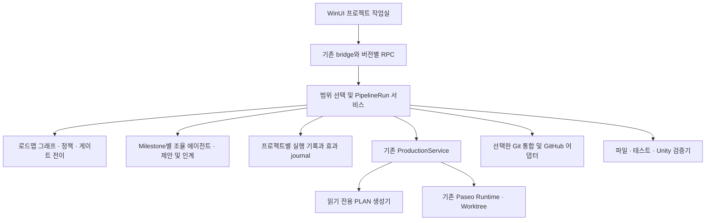

# Orchiva 로드맵 기반 게임 개발 파이프라인 기술 검토

2026-11-26 (Asia/Seoul) · 개발자 검토용 제안 · Windows 로컬 작업본 `codex/desktop-ui-alignment`, HEAD `3aad026` 및 작업 트리의 UI-A 변경 기준. 저장소 코드·기존 검증 기록·외부 공식 문서를 검토했다. 아래 PoC와 도입 순서는 착수 전 설계 후보이며 기존 계획의 상태는 [계획 목록](../plans/README.md)에서 확인할 수 있다.

## 6.1 Executive Summary

**적용을 권장한다. 첫 기능은 “Phase 01의 M02~M04”라는 선택을 고정된 작업 목록으로 바꾸고, 그중 하나를 기존 제작 요청으로 끝까지 실행하는 것이다.** 개발자는 관련 기획서·지침, 범위 밖 선행 작업, 다음 승인 사유를 실행 전에 확인한다. 각 Feature의 상세 PLAN과 결과는 지금 쓰는 제작 화면에서 검토할 수 있다.

기존 단건 제작과 신규 Milestone 자동화는 같은 프로젝트에서 선택해 쓸 수 있도록 설계한다. Milestone당 Feature는 1~5개이며, 각 Milestone에는 작업 간 의존성과 인계를 검토할 조율 담당을 둔다. 이 제안은 아직 구현 전이다.

가장 적합한 방향은 **Orchiva가 범위·의존성·품질 판정·진행 상태를 소유하고, 개별 작업은 기존 Paseo 실행부에 맡기는 Hybrid**다. MVP는 요청 한 건의 격리 실행과 복구를 검증했다. 데스크톱 D2·D3는 여기에 프로젝트별 실제 지침 파일, AI PLAN 버전, 입력 스냅샷, 결과 검토와 선택 적용을 더했다. 외부 도구 없이도 첫 가설을 시험할 수 있다. [M6 결과](../decisions/m6-acceptance.md) · [D2·D3 결과](../decisions/desktop-d2-d3-completion.md)

핵심 난점은 세 가지다. 현재 전역 단일 슬롯은 구·신 요청의 중복 실행을 함께 막는다. 기존 제작은 미커밋 소스도 입력에 포함하므로 그대로 PR을 만들면 사용자 변경이 섞일 수 있다. 게임 에셋은 현재 입력·증거의 크기 한도를 넘기 쉽다. 따라서 **로컬 직렬 실행과 재개 → 승인된 변경만 통합 → 제한 병렬 및 Unity 빌드** 순서로 검증한다. UI-A와 D1~D3 GUI 수용 상황을 확인한 후 별도 착수 여부를 결정하고, D5의 분야별 산출물 검증과 D6의 새 PC 수용에 결과를 연결한다.

## 6.2 Current State Analysis

| 조사 대상 | 현재 작업본에서 확인한 동작과 경계 |
| --- | --- |
| 진입점과 계층 | 브라우저의 React Native Plugin과 WinUI 3/.NET 데스크톱이 공존한다. 데스크톱은 C# → stdio bridge → 공개 Paseo SDK의 Plugin RPC → TypeScript 서비스 경로를 쓴다. Zod 계약, handshake의 환경·capability 대조, 1 MiB 프레임 제한이 있다. 연결 종료와 daemon 수명은 분리된다. [Plugin 등록](../../index.server.ts) · [데스크톱 계약](../../shared/contracts/desktop-protocol.ts) · [BridgeSession](../../bridge/protocol.ts) |
| REQUEST·TASK·PLAN | v2 `RequestRecord` 한 건에 `token`, 요청 ID, `taskId`, Request PLAN과 Task PLAN, 각 revision·attempt·result·판정·command 이력이 있다. 두 PLAN은 요청 관점과 실행 관점이다. 독립 스케줄 가능한 두 작업으로 세지 않는다. v3 `Production`은 이 엔진을 감싸고 프로젝트 ID, 정형 제작 입력, `planVersions`, journal, review, export를 저장한다. 새 요청/수정 요청의 부모 결과 연결은 참조 맥락이다. [v2 계약](../../shared/contracts/feature-request.ts) · [v3 계약](../../shared/contracts/desktop-production.ts) · [계획 구성](../../server/domain/request-plan.ts) |
| 프로젝트와 지침 | `Projects`가 로컬 등록부와 대상 프로젝트의 `docs/.orchiva/project.json`을 관리한다. 소스·결과 루트를 구분하고 초기화 변경을 미리 보여준다. 대상 게임의 루트 AGENTS와 `instructionRefs(path, scope, required)`를 읽어 누락·경로·지도 링크·하위 AGENTS를 점검한다. 저장 시 기대 해시와 백업을 사용한다. `scope`는 기록되지만 `inspectProjectInstructions`는 등록 목록 전체를 순회한다. Orchiva 개발 저장소 자체의 하위 AGENTS 규칙과 대상 게임 초기화 정책은 적용 위치가 다르다. [Projects](../../server/application/desktop/projects.ts) · [초기화 템플릿](../../server/application/desktop/project-templates.ts) · [지침 CLI](../../scripts/project-instructions.mjs) |
| 계획과 입력 고정 | 기존 MVP는 정형 템플릿을 쓴다. 데스크톱은 `CodexPlanGenerator`가 별도 입력 사본에서 읽기 전용 Codex CLI로 목표·범위·작업 순서·산출물·검증·검토·실패 복구의 일곱 절을 작성한다. 게시는 절 존재와 길이를 검사한다. `syncPlan`은 로컬 Markdown 외부 편집을 새 버전으로 읽는다. 시작 시 PLAN 파일 해시, 기준 커밋, 지침 지문, 설정 revision, 입력·파일 상태를 재대조한다. [생성기](../../server/adapters/paseo/plan-generator.ts) · [ProductionService](../../server/application/desktop/production.ts) · [captureInput](../../server/application/desktop/snapshots.ts) |
| 실행·복구·저장 | `StartFeatureRequest`, `TrackExecution`, `RecoverRequest`와 Runtime 포트가 준비·실행·관측·복구를 담당한다. 데스크톱 제작은 Paseo Workspace 안에 Codex 에이전트를 만든다. 계획 작성 CLI 프로세스와 수명이 다르다. `ProductionStore`는 프로젝트별 요청 JSON과 소유권을 사용한다. `assertSlot`은 v2와 등록 프로젝트 전체의 active·pending·unknown·손상을 검사한다. CLI 프로세스나 메시지 전달이 불확실하면 대조가 필요하다. 등록 프로젝트가 늘어도 가용 슬롯은 하나다. [실행 포트](../../server/application/ports.ts) · [서비스](../../server/application/desktop/production.ts) · [저장소](../../server/adapters/storage/production-store.ts) · [복구](../../server/application/recover-request.ts) |
| Git·Workspace·결과 적용 | `baseRef`를 SHA로 해석해 `orchiva/<taskId 소문자>` 브랜치의 Worktree를 만들고 공통 Git 디렉터리·HEAD를 확인한다. 데스크톱은 그 위에 승인 시점 소스 스냅샷을 재현한다. 제작 프롬프트는 commit/push/merge를 금지한다. B안은 결과 지문 확인 → 내보내기 → 사용자가 고른 파일의 before/after 해시·백업을 이용한 적용/undo다. 제품 경로에서 GitHub Issue/PR API·병합 관리자는 발견되지 않았다. MVP sandbox의 origin 제한은 데스크톱 등록 루트 검사와 별도다. [고정 SHA](../../server/adapters/paseo/pinned-workspace.ts) · [브랜치](../../server/adapters/paseo/runtime.ts) · [DesktopRuntime](../../server/adapters/paseo/desktop-runtime.ts) · [경로 검사](../../server/config/project-config.ts) · [산출물](../../server/application/desktop/artifacts.ts) |
| 분야·역할·검증 | v3 제작 분야는 `planning`·`coding`, 모드는 `new`·`modify`, 모델은 조회한 `codex/*`와 사고 수준이다. 데스크톱 `files` 프로필은 자동 Node 검사를 추가하지 않고, `node-test`는 snapshot의 해당 테스트 경로 최대 8개를 선택한다. v2에는 파일 문자열과 Node 검사가 있다. 실행 결과와 현재 지문 대조 후 사용자 품질 확인·검사 확인을 받아 완료한다. 초기화 템플릿과 고정 제작 절차는 있으나 사용자 정의 Recipe, DAG 실행기, 역할별 모델/도구 배정 계약은 찾지 못했다. [제작 계약](../../shared/contracts/desktop-production.ts) · [검사 실행](../../server/adapters/storage/evidence.ts) · [제작·검토](../../server/application/desktop/production.ts) |
| UI와 검증 수준 | 프로젝트 선택·초기화 → 작업 시작 → 기획/코딩 새 요청 또는 수정 → PLAN → 실행 → 결과 → 내보내기/선택 적용으로 이어진다. 프로젝트 지침·PLAN 이력·연결 상태가 있고 상담 메뉴는 준비 중이다. Plugin MVP 화면도 남아 있다. 데스크톱 실제 run 007/008은 소규모 과제의 성공·실패·재개·적용 근거다. 당시 자동 테스트 108건, C# 13건 통과 기록이 있다. UI-A는 작업 트리에서 일부 보정·모의 검증·화면 자료가 있으나 G01~G11 전체 GUI 수용은 대기다. [WinUI 탐색](../../desktop/Orchiva.Desktop/MainWindow.xaml) · [제작 작업실](../../desktop/Orchiva.Desktop/ProductionWorkspace.xaml) · [D2·D3 근거](../evidence/desktop-transition/d2-d3-20261116/summary.json) · [UI-A 기록](../decisions/desktop-ui-alignment.md) |

**설계 문서의 시점에 유의한다.** 초기 PoC의 조회 중심 관측은 M3의 백그라운드 대조보다 앞선 기록이다. MVP 문서에 후속 범위로 남은 다중 프로젝트·AI 계획은 D2·D3에서 위 범위만큼 구현됐다. D4는 질의·상담, D5는 아트·사운드·특수효과, D6는 설치·통합 수용으로 미착수다. Orchiva 저장소의 M0~M6 개발 PLAN 목록 자체가 게임 프로젝트의 로드맵 엔진이라는 근거도 없다. [PoC](../decisions/poc-results.md) · [MVP 설계](mvp-design.md) · [데스크톱 인계](desktop-handoff.md) · [현재 단계](../plans/desktop-transition.md)

## 6.3 Gap Analysis

상태는 해당 행의 요구사항 기준이다. 우선순위 P0는 첫 로컬 검증, P1은 통합·병렬 실증, P2는 분야·운영 확장이다. 난이도는 현재 계약·복구 방식에 미치는 영향 기준의 상대 추정이다.

| 요구사항 | 현재 상태 | 기존 기능 | 재사용 | 추가 개발 | 난이도 | 순위 | 주요 위험 |
| --- | --- | --- | --- | --- | --- | --- | --- |
| 프로젝트 등록·지침 원본 편집 | IMPLEMENTED | Projects, instructionRefs, 해시 | 직접 | 기본 경로 없음 | 낮음 | P0 | 외부 편집 |
| 5.1 로드맵 구간·완료 식별 | NOT_IMPLEMENTED | 프로젝트 ID, PLAN 목록 | 식별·저장 경계 | 항목 ID, 범위 동결, 범위 밖 의존 보고 | 중 | P0 | 이름 변경·범위 확장 |
| 5.2 작업별 컨텍스트 | PARTIALLY_IMPLEMENTED | 지침 검사, InputSnapshot | 확장 | 선택 규칙·정책 충돌·예산 | 높음 | P0 | 필수 지침 누락·대형 에셋 |
| 5.3 PLAN 자동 생성·연결 | PARTIALLY_IMPLEMENTED | 읽기 전용 AI, revision, 해시 | 직접+확장 | 로드맵 입력, 구조 검증, 변경 영향 | 중 | P0 | 자연어로 권한 확대 |
| 5.4 Issue 동기화 | NOT_IMPLEMENTED | 로컬 PLAN, 명령 journal | 패턴 | 원격 매핑·대조·충돌 처리 | 중 | P1 | 생성 응답 유실·외부 편집 |
| 5.5 의존성·충돌·병렬 | NOT_IMPLEMENTED | 단일 슬롯, 요청 잠금 | 복구 원칙 | DAG, 자원 예약, 공정 배정 | 높음 | P0→P1 | 이중 실행·동일 Scene 쓰기 |
| 5.6 역할별 작업 배정 | PARTIALLY_IMPLEMENTED | 분야·모델·수준 선택 | 입력 확장 | 역할·도구 권한·산출물 계약 | 중 | P1 | 생성자 자기 승인 |
| 5.7 Worktree 격리·PR 통합 | PARTIALLY_IMPLEMENTED | SHA 고정, 지문, B안 | 격리·차이 계산 | 통합 기준·commit·PR·정리 | 높음 | P1 | 사용자 변경 동반 게시 |
| 5.8 계층별 품질 검증 | PARTIALLY_IMPLEMENTED | Node/파일, 결과별 수동 검토 | 증거·판정 | 통합·Milestone·Phase 게이트 | 높음 | P0→P1 | 검사 삭제·미실행 성공 처리 |
| 5.9 Unity 테스트·빌드 | NOT_IMPLEMENTED | 실행 포트·증거 저장 | 계약 패턴 | Editor 실행기·로그·Player smoke | 높음 | P1 | import 비용·라이선스·참조 손상 |
| 5.10 장기 상태·복구 | PARTIALLY_IMPLEMENTED | v2/v3, intent, 재개 | 요청 단위 직접 | run/노드/병합 단위 복구 | 높음 | P0 | 거짓 완료·재전송 |
| 5.11 실패·개발자 승인 | PARTIALLY_IMPLEMENTED | 실패 분류·재검증·검토·권한 응답 | 직접+확장 | 제품 결정·병합 승인, 후속 차단 | 중 | P0 | 오래된 승인 재사용 |
| 5.12 Orchestrator.inc 호환 | UNKNOWN | Orchiva Runtime 포트 | 의미 비교만 | 후보 어댑터 계약 실증 시 판단 | 높음 | P2 | 서로 다른 상태 소유자 |
| 5.13 반복 사용 템플릿 | PARTIALLY_IMPLEMENTED | 프로젝트 골격·PLAN 절·제작 프로필 | 조합 | 버전 고정된 작업 유형별 기본값 | 중 | P1 | 프로젝트 예외 확산 |
| 5.13 아트·사운드·효과 제작 | PLANNED | D5 계획 | D5와 공동 설계 | 실제 생성기·미리보기·검사 | 높음 | P2 | 대체 텍스트를 산출물로 오인 |
| 5.14 로드맵 UI | NOT_IMPLEMENTED | 작업 시작·PLAN 이력·결과 화면 | 상세 재사용 | 범위 선택·의존·승인 대기 요약 | 중 | P0→P1 | 이중 입력·이력 불일치 |

## 6.4 Architecture Proposal

### 서비스 경계와 의존 방향

위 구성은 제안이다. 범위 선택과 상태 전이는 TypeScript 도메인·애플리케이션에 두고, WinUI는 조회와 명시적 명령을 보낸다. 새 메서드는 기존 bridge의 capability 목록에 광고한다. 구버전 연결에는 지원되는 기존 제작 기능을 제공한다. 목록·이벤트는 페이지 단위로 보내고 대형 로그·이미지는 요약과 파일 참조로 전달한다. 계획 AI는 문서에서 Feature와 의존성 **후보**를 추출한다. 확정된 그래프의 배정, 권한 부여, 테스트 집계와 병합은 서비스가 결정한다.

처음에는 run 하나가 기존 제작 API에 정형 입력을 넣고 `projectId/token`을 보존하면 된다. 단일 실행에서 검증한 start/resume/review를 복제할 이유가 없다. 실행 제약은 `ProductionService.assertSlot`뿐 아니라 v2 슬롯, `maxActiveTasks: 1` 계약, 계획 작성과 journal, 관측 루프, export/apply의 전역 잠금에도 걸려 있다. 병렬 단계에서 이 경로를 모두 조사하고, 기존 v2 호출도 같은 승인된 용량 정책을 거치게 한다. 전역 잠금 안에서 하위 서비스의 전역 잠금을 다시 잡지 않도록 배정 intent를 먼저 짧게 커밋하고 해제한 뒤 결정적인 명령 키로 제작 서비스를 호출한다. [슬롯 계약](../../shared/contracts/feature-request.ts) · [v2 실행 슬롯](../../server/application/execution-slot.ts) · [v3 서비스](../../server/application/desktop/production.ts) · [결과 반영](../../server/application/desktop/artifacts.ts)

### 기존 제작과 Milestone 자동화의 공존

프로젝트의 ‘작업 시작’에서 **단건 제작**과 **Milestone 실행**을 선택하는 설계를 권장한다. 단건 제작은 지금처럼 새 요청이나 수정 요청을 작성하고 PLAN 확인·실행·결과 검토·선택 적용으로 이어진다. 로드맵이나 조율 에이전트가 필요 없다. Milestone 실행에서는 개발자가 로드맵 구간을 선택하면 각 Feature를 기존 제작 요청에 연결한다. 두 방식에서 같은 PLAN·결과 상세와 복구 기능을 쓰므로 Milestone에서 실패한 Feature도 해당 요청 화면에서 보완할 수 있다.

공존은 같은 프로젝트에서 두 진입점을 사용할 수 있다는 뜻이다. 첫 단계에서는 두 방식이 기존 전역 실행 슬롯 하나를 공유한다. 예를 들어 Milestone 실행 중 긴급 수정이 생기면 신규 Feature 배정을 일시중지하고 현재 작업이 슬롯을 반환한 뒤 단건 수정을 실행한다. 이후 Milestone을 재개할 때는 달라진 기준 SHA·입력과 선행 결과를 대조한다. 단건 결과를 Milestone에 사용하려면 사용자가 해당 결과 ID를 명시적으로 연결하고 Feature의 수용 조건을 확인한다.

### Milestone별 Orchestrator 에이전트

**실행에 포함된 Milestone마다 조율 담당 하나를 두는 안을 권장한다.** 예를 들어 M02 담당은 다섯 Feature가 같은 점수 규칙을 참조하는지 확인하고, 기획 결과를 기다리는 작업과 바로 시작할 작업을 설명한다. Feature별 상세 PLAN은 기존 생성기가 작성한다. 이 역할은 Orchiva 내부의 설계이며 외부 Orchestrator.inc 채택과 독립적이다.

| 호출 시점 | 조율 에이전트가 맡는 일 | Orchiva 서비스와 개발자가 맡는 일 |
| --- | --- | --- |
| Milestone 시작 | 목표·승인된 범위·선행 Milestone 인계를 읽고 분해안, 의존 간선, 역할 및 관련 지침을 제안 | 서비스가 개수·범위·순환·정책을 검사하고 개발자가 PLAN을 확인 |
| 진행 중 예외 | 선행 결과 변경, 실패 또는 기획 충돌의 영향을 받는 Feature를 지목하고 재계획·재개 선택지를 제안 | 서비스가 현재 revision과 증거를 대조해 슬롯을 예약하고 제작을 시작. 범위 변경·검증 완화는 개발자가 결정 |
| Milestone 종료 | 승인된 산출물·통합 SHA·남은 문제를 요약해 다음 Milestone에 인계 | 서비스가 필수 게이트와 승인 근거로 완료 판정. 다음 담당은 저장된 인계 자료를 읽고 시작 |

담당의 정체성은 `runId + milestoneId`로 유지하고 모델은 시작·예외·인계 때 호출한다. 담당이 상시 세션으로 제작 슬롯을 점유하면 단일 슬롯에서는 자신이 기다리는 Feature가 시작할 수 없다. 따라서 조율 호출이 끝나면 슬롯을 반환하고 worker가 실행하게 한다. 평상시 진행 표시는 저장된 이벤트로 갱신한다. 제안과 채택 여부는 입력 revision과 함께 저장한다. 앱 재시작이나 모델 응답 지연 뒤에도 이미 채택한 제안은 다시 배정하지 않으며, 담당에게 직접 세션 생성·Git 게시·품질 승인 권한을 주지 않는다.

장점은 Feature 사이의 기획 불일치와 인계 누락을 한 담당이 찾을 수 있다는 점이다. 비용은 모델 호출과 중복 계획 검토다. Feature가 하나뿐이고 의존·충돌이 없으면 기존 PLAN과 결과로 인계 기록을 만들어 별도의 조율 호출을 생략할 수 있다. PoC에서는 동일한 그래프를 서비스만으로 실행한 경우와 비교해 **사전에 찾은 충돌, 잘못된 차단, 추가 호출 비용**을 기록한다.

### 스크립트 실행과 지침 기반 판단의 분담

Milestone의 각 단계에서 **명시된 입력·정책·관측 결과만으로 답을 정할 수 있는 일**은 코드로 실행한다. **목표를 달성할 방법이 여러 가지이고 문서의 의미나 결과물의 품질을 해석해야 하는 일**은 담당 에이전트에게 위임한다. 스크립트는 검사·도구 호출을 수행하고, 실행 허용과 상태 전이는 기존 Orchiva 서비스가 한 곳에서 결정한다. 같은 규칙을 운영 스크립트와 서비스에 이중으로 작성할 필요가 없다.

| 단계 | 지침 안에서 에이전트가 판단하는 일 | 스크립트·서비스가 집행하는 일 |
| --- | --- | --- |
| 범위·PLAN | Milestone 담당은 기획서를 해석해 함께 검증할 Feature와 선행 관계를 제안한다. Planner는 필요한 산출물과 작업 순서를 구체화한다. | Feature 1~5개, ID·범위·순환을 검사한다. 승인된 PLAN과 지침 버전을 고정하고 허용 경로·도구·필수 검사를 기록한다. |
| 배정·제작 | 제작 에이전트는 승인된 목표·작업 영역 안에서 자료구조, 코드 구성, 화면 배치 등 위임된 방법을 선택하고 결과물을 만든다. | 선행 결과와 슬롯을 확인하고 전용 Worktree와 세션을 준비한다. 호출 전에 도구 권한을 확인하고 결과 수용 전 실제 변경 경로를 대조한다. |
| 검사·보완 | 에이전트는 실패 로그를 해석해 원인을 찾고, 같은 PLAN 안에서 수정 방법을 골라 보완한다. 리뷰어는 규격만으로 잡기 어려운 사용성이나 기획 모순을 지적한다. | 승인 때 고정한 검사로 변경본을 재검증하고 결과 ID와 증거를 보존한다. 실패·누락된 검사, 범위 밖 변경, 재시도 예산 소진에 맞춰 후속 작업을 대기시킨다. |
| 통합·인계 | Milestone 담당은 수용한 산출물과 남은 쟁점을 해석해 다음 담당에게 전달한다. | 필요한 리뷰·승인과 검사 대상 SHA를 대조하고 설정된 통합·빌드 절차를 실행한다. 필수 결과와 승인 근거가 갖춰진 시점에 진행 상태를 갱신한다. |

**두 흐름의 접점은 승인된 PLAN과 결과 증거다.** 예를 들어 “점수 획득 후 HUD에 새 값이 표시된다”는 조건과 점수 계산 규칙이 정해져 있다면, 제작 에이전트는 허용된 파일 안에서 이벤트 연결 방법을 선택해 구현할 수 있다. 구현 방법마다 재승인을 받을 필요가 없다. 스크립트는 지정 시나리오를 실행해 실제 표시값과 기대값을 비교한다. 기획서 두 곳의 배점이 서로 달라 기대값을 정할 수 없으면 Milestone 담당은 상충하는 근거와 영향을 제시하고 개발자가 규칙을 결정한다. 합의 후 새 PLAN 버전으로 검증을 재개한다.

### A·B·C 선택

| 기준 | A. 실행부까지 자체 관리 | B. 외부 Orchestrator가 실행·세션 관리 | C. 상태는 Orchiva, 실행은 어댑터 |
| --- | --- | --- | --- |
| 현 구조·재사용 | 도메인·증거 활용 가능. Paseo가 맡은 세션·격리의 대체 비용이 큼 | 지침·PLAN UI 활용 가능. 기존 세션과 요청 복구에 번역 필요 | D3 요청과 Paseo를 첫 어댑터로 활용 |
| 개발·유지 비용 | 초기·장기 모두 높음. 프로세스·SCM 변화까지 관리 | 세션 UI·실행 기능을 빌릴 수 있으나 두 제품의 업그레이드·지원 비용 발생 | 초기 범위는 그래프·journal 중심. 새 어댑터마다 계약 시험 필요 |
| 확장·런타임 교체·종속성 | 자유도 높음. 신규 런타임마다 자체 개발 | 외부 지원 목록·수명 모델·공개 인터페이스에 좌우 | 실행별 어댑터 고정. 기존 작업 관측과 신규 런타임 배정을 따로 확장 |
| 상태 일관성·복구 | 단일 소유권을 설계할 수 있으나 검증 부담이 큼 | 세션/PR 상태와 게임 완료 조건을 대조해야 함. 응답 유실 시 중복 위험 | Orchiva가 run·승인·결과 원본을 소유. 원격 세션·PR은 ID로 재관측 |
| 사용자 경험·장기 방향 | 일관된 UI 가능. 게임 기능 도입이 늦어짐 | 범용 개발 세션 UI 활용 가능. 두 앱의 승인·진행 표시가 어긋날 수 있음 | 기존 작업실에서 게임 기준으로 판단. 미지원 기능은 배정 전에 표시 |

Orchestrator.inc 공식 문서는 로컬 daemon, 세션별 격리 Worktree, 복수 worker의 병렬 작업, PR·검사·리뷰 상태 관측, CLI의 세션 제어를 설명한다. **문서상 가능한 것**은 실행 어댑터 후보로 삼을 근거다. Orchiva가 정한 고정 SHA·입력 overlay·생성 명령 재호출·미확정 전송 대조·동일 결과 지문·Unity 게이트를 같은 의미로 보장하는지는 미검증이다. 도입 판단은 격리 fixture에서 시작 응답 유실 후 자원 수, 재시작 후 ID, 권한 거부, 종료 후 증거 회수를 Paseo와 같은 기준으로 비교한 뒤 한다. 한 노드의 Workspace 생성 주체는 하나만 둔다. [공식 아키텍처](https://docs.orchestrator.inc/architecture/) · [병렬 작업](https://docs.orchestrator.inc/guides/parallel-issues/) · [공식 CLI](https://docs.orchestrator.inc/cli/)

### 로컬 PLAN, GitHub Issue와 Git 통합

- **원본과 공개 범위.** 사람과 Git이 다루는 PLAN 원본은 대상 게임의 `docs/plans/`에 둔다. 승인한 공개용 PLAN 본문을 로컬과 Issue에 동일하게 기록하고 정규화된 UTF-8/LF 본문 해시를 비교한다. 외부 공유가 허용되지 않는 문서·비밀값이 포함되면 동기화를 보류한다. 상세 snapshot과 원시 로그는 로컬에 둔다. PLAN ID는 로컬에서 먼저 발급하며 Issue 번호는 연결 메타데이터로 보관한다. 최초 생성 전에도 본문을 확정할 수 있다.
- **원격 효과와 충돌.** `repoId + planId`별 한 작성자와 영속 전송 대기열을 두고, 생성 전 PLAN ID가 든 본문·대상 저장소를 기록한다. 응답이 유실되면 기존 매핑과 열림/닫힘 양쪽의 Issue를 조회해 식별한다. 조회 지연·후보 다수·권한 오류는 미확정으로 남긴다. 수정 전 마지막 동기화 본문 해시와 현재 원격 본문을 비교한다. 둘 다 바뀌면 diff를 보여주고 개발자가 원격 편집을 새 로컬 revision으로 수용하거나 로컬본 재게시를 선택한다. 갱신 후 다시 읽어 해시를 검증한다. 읽기와 쓰기 사이 외부 편집이 가능한 API이므로 동시 작성의 완전 배제는 PoC에서 별도 검증한다.
- **상태와 재시도.** 작업 상태 원본은 Orchiva 실행 기록이다. Issue 라벨·상태는 그 투영이고 커밋·PR·테스트 요약은 결과 ID별 연결로 유지한다. 외부에서 Issue를 닫아도 로컬 완료 판정은 생성하지 않는다. 승인된 통합 및 결과 기록 후 종료한다. 속도 제한·일시 장애는 서버 대기 지시와 제한된 backoff를 적용한다. 연결 해제·권한 부족은 로컬 상태에 표시한다. 로컬 전용 모드는 원격 효과를 만들지 않고 승인된 로컬 통합 SHA로 동일 게이트를 진행한다. GitHub 필수 프로젝트에서는 게시/원격 통합을 요구하는 단계에서 대기한다.
- **CLI와 API.** 기존 사용자가 인증한 `gh`가 있고 게시 권한을 전용 프로세스로 격리할 수 있는 시험 환경이면 PoC는 `gh api`와 구조화 JSON으로 운반 계층을 작게 유지한다. 장기 서비스에서 저장소별 최소권한 자격·HTTP 상태·rate limit·재시도를 직접 관리할 때는 REST 어댑터가 적합하다. 어느 쪽이든 UI 문자열 파싱, 에이전트에 대한 게시 자격 전달, Issue 번호를 작업 키로 쓰는 방식은 피한다. [GitHub CLI](https://cli.github.com/manual/gh_api) · [Issues REST](https://docs.github.com/en/rest/issues/issues) · [Pull requests REST](https://docs.github.com/en/rest/pulls/pulls)
- **브랜치 정책.** 프로젝트가 Git Flow를 고르면 `main`은 배포 가능 버전, `develop`은 통합, `feature/<planId>-<slug>`는 작업, `release/*`·`hotfix/*`는 별도 승인 경로다. Issue 번호는 선택적 표시다. trunk 기반 프로젝트는 통합 ref와 허용 head 패턴을 설정할 수 있다. 통합 전에 허용 원격의 최신 기준 SHA를 확인하고 후속 작업은 선행 merge SHA가 포함된 기준에서 분기한다. Feature가 자신의 검토를 승인할 수 없도록 작업 계정과 게시 권한을 분리한다. 보호 브랜치 직접 push와 배포는 기본 차단하고, 허용 PR에 필수 리뷰·상태 검사·검사한 head SHA를 요구한다. 기준이 이동하면 병합 후보를 재검증한다. [GitHub 보호 브랜치](https://docs.github.com/en/repositories/configuring-branches-and-merges-in-your-repository/managing-protected-branches/about-protected-branches) · [병합 API](https://docs.github.com/en/rest/pulls/pulls)
- **B안과의 접점.** 실행 시작 시 결과 수용 방식(사용자 선택 적용 / 관리 브랜치 통합)을 고정한다. 같은 변경을 두 경로로 중복 반영하지 않는다. 첫 PR 시험은 깨끗한 통합 SHA 사본만 입력으로 허용한다. 사용자 편집·미추적 파일·내부 PLAN·로컬 증거를 포함한 Worktree 전체를 커밋하지 않는다. 게시 서비스가 승인된 결과의 경로·해시·추가/삭제를 검증한 후 깨끗한 전용 checkout에 적용하고 그 커밋을 재검사한다. 사용자 checkout은 그대로 둘 수 있다. 병합 충돌은 전용 통합 공간에 보존해 새 head 재검토를 요청한다. 병합 후에도 증거·산출물 회수, 소유 ID, dirty 여부를 확인한 작업만 정리하고 실패·미확정 작업의 Worktree는 보존한다.

### 검증기와 게임 엔진

| 게이트 | 통과에 필요한 근거 | 실패 처리 |
| --- | --- | --- |
| PLAN | 허용 경로 diff, 산출물 규격, 컴파일·단위 검사, 지정 EditMode/필요 PlayMode 결과와 사람 검토 | 변경 영역·검사 집합·결과 지문이 다르면 재검토. 미실행/오류/누락 구분 |
| Integration | 최신 통합 기준과 작업 head의 병합 후보에서 회귀·시스템 연동·Scene/Prefab 참조 검사, 병합 결과 SHA 확인 | 기준 이동·충돌 시 통합 대기. 병합 후 실패는 후속 개발 차단 |
| Milestone | 필수 Feature 모두 수용, 해당 통합 SHA의 통합 테스트, 대상 플랫폼 빌드, 해당 빌드 실행·smoke·핵심 플레이 시나리오 | 빌드 로그·해시·재현 조건 저장. 다음 Milestone 시작 보류 |
| Phase | 지정 빌드로 개발자 플레이 테스트, 밸런스·조작감·UI/UX 판정, 다음 Phase 진행 결정 | 수정 요청 또는 범위 재검토. 자동 통과 불가가 기본값 |

프로젝트·작업 유형별 `validationProfile`을 버전 관리하고 PLAN 승인 때 검사 ID, 대상·예상 테스트 집합, 도구 버전, 제한 시간, 필수 수동 판정자를 동결한다. 실행부 밖의 검증기가 신뢰하는 테스트 원본과 CI 설정을 읽고 실패 수·skip·탐색 건수·종료 코드·결과 파일·결과 SHA를 대조한다. 시험 삭제/완화, 검증기 변경, 증거 누락, 필수 검사 0건은 승인 경로를 막는다. 테스트 자체 수정이 업무면 이유와 독립 리뷰를 거쳐 새 기준으로 다시 실행하며 이전 실패도 남긴다. 개발자는 정책 개정은 승인할 수 있으나 이미 실패한 결과를 소급 통과시킬 수 없다.

**Unity는 첫 엔진 전용 검증기 후보**다. 코어에는 입력 SHA·대상·프로필·결과/증거 계약만 둔다. 프로젝트의 `ProjectVersion.txt`, `Packages/manifest.json`, `packages-lock.json`, 플랫폼 모듈·빌드 설정을 바탕으로 실행 환경을 확인한다. Unity CLI를 쓰는 환경은 실제 Editor·프로젝트 경로를 식별하고, 무인 검증은 고정 Editor의 Batch Mode와 Test Framework를 후보로 한다. EditMode/PlayMode 각각 결과 XML과 Editor 로그를 보존한다. 승인된 빌드 진입점에서 `BuildPipeline.BuildPlayer`의 BuildReport와 대상·산출물 해시를 확인하고, 빌드한 Player에서 첫 장면 진입과 정의된 조작/클리어 신호를 시간 제한 내 확인한다. 공식 인터페이스 확인 범위는 Unity 6.0/Test Framework 1.4이며 대상 게임의 호환 버전은 PoC 입력으로 정한다. [Editor 명령행](https://docs.unity3d.com/6000.0/Documentation/Manual/EditorCommandLineArguments.html) · [Test Framework](https://docs.unity3d.com/Packages/com.unity.test-framework@1.4/manual/reference-command-line.html) · [BuildPlayer](https://docs.unity3d.com/6000.0/Documentation/ScriptReference/BuildPipeline.BuildPlayer.html)

Worktree별 프로젝트 경로와 쓰기 가능한 Library·Temp를 분리한다. Editor는 처음에 전체 1슬롯으로 두고 cold/warm import 시간, 최고 디스크·메모리, 플랫폼 전환 비용을 측정한다. 에이전트 병렬 수와 Editor 병렬 수는 별개다. Scene/Prefab은 경로 및 GUID로 충돌을 예약하고 에셋 이동·삭제는 `.meta`와 함께 판정한다. `ProjectSettings`, Packages와 공유 인터페이스는 배타 변경 후보로 둔다. UnityYAMLMerge 결과에도 GUID 해소, 로드 및 플레이 검사를 요구한다. 다른 엔진용 범용 플러그인 체계는 두 번째 실사용 요구가 생길 때 결정한다. [Unity 에셋 메타데이터](https://docs.unity3d.com/6000.0/Documentation/Manual/AssetMetadata.html) · [Smart merge](https://docs.unity3d.com/6000.0/Documentation/Manual/SmartMerge.html)

## 6.5 Domain Model Proposal

### 로드맵에서 실행 요청까지

| 모델 후보 또는 기존 모델 | 정체성·관계 | 영속화와 변경 규칙 |
| --- | --- | --- |
| Roadmap revision | 프로젝트 안의 Phase → 순서가 있는 Milestone → Feature. 표시명·순번과 독립적인 항목 ID. Feature에 소유 Milestone 한 개와 다른 Feature ID 의존 목록 | 대상 프로젝트 Git 문서(후보 `docs/roadmap/`)의 Markdown 설명과 기계 판독 메타데이터를 함께 버전 관리. ID·순서·의존·필수 여부는 메타데이터 한 곳에서 정의하고 UI 트리는 여기에서 생성. GDD·와이어프레임은 경로·버전으로 참조 |
| PipelineRun | `projectId/runId`, roadmap revision·해시, 시작/종료 ID(양끝 포함), 선택된 Feature ID 집합·간선, 정책 버전, 실행 모드 | 프로젝트의 별도 버전 있는 실행 기록(후보 `docs/.orchiva/runs/<runId>.json`). 파싱 결과·범위·제외 항목·승인자 저장. 이름/순서가 바뀌어도 실행 범위 고정 |
| 실행 노드 | `runId/nodeId`가 Feature 한 건의 수용 결과를 추적. 첫 버전은 Feature당 v3 Production 한 건. 그 안의 기존 REQ/TASK/두 PLAN을 그대로 사용 | `projectId/token`, 승인 PLAN revision/hash, 결과 ID·지문·시도, 통합 SHA, 선행 산출물 ID를 연결. PLAN의 세부 작업은 체크리스트. 독립 승인·재시도가 필요한 추가 작업만 명시적으로 별도 노드로 분할 |
| PLAN revision | 기존 `planVersions` 본문과 실행용 두 PLAN 재사용. 로드맵의 Feature ID는 안정 식별자, PLAN 이름·브랜치·Issue는 별도 연결 | 기존 일곱 절에 목표·요구·참조·선행 입력·세부 작업·산출물·완료/테스트·복구 기입. 구조화 부속 필드에 PLAN ID/revision, Feature ID, 분야, 포함·제외, 허용 경로와 예상 경로, 검증 방법·프로필, 기준 SHA, 브랜치·Issue 참조 저장. 예상 경로는 허용 영역의 부분집합 |
| 실행 입력·산출물 명세 | 기존 InputSnapshot·결과 ID·manifest 위에 선택한 문서/절·해시, 역할·모델·템플릿 버전, 선행 산출물의 생산자·경로·해시·형식 기록 | 나중에 다시 열 수 있는 Git blob 또는 불변 사본을 보관. 결과가 교체되면 해당 버전을 소비한 미실행 노드만 재계획하고 실행·완료 이력에 옛 참조 보존 |
| Gate 결과·승인·외부 효과 | 범위(PLAN/통합/Milestone/Phase), 대상 SHA 또는 산출물 해시, 검사 프로필 버전, 결과와 증거, 승인자·시각·사유. Issue/PR/merge/build 효과마다 고유 명령 키 | 현재 intent·대조 방식을 확장. 효과 전 의도, 완료 후 외부 ID·결과를 저장. 상태 저장과 외부 작업 사이 중단을 정상 복구 경로로 취급 |

**Milestone의 크기.** 한 Milestone에 소속되는 고유 Feature는 최소 1개, 최대 5개다. 필수·선택 Feature를 모두 세고, Feature 안의 세부 Task·PLAN revision·재시도·다른 Milestone의 선행 참조는 개수를 늘리지 않는다. 편집 중인 빈 초안은 저장할 수 있고 실행 승인은 1개부터 가능하다. 6번째 Feature를 제안하면 함께 통합 검증할 목표를 기준으로 둘로 나누거나 기존 항목을 옮기는 안을 보여준다. 개발자가 분할과 의존 관계를 확인한 뒤 반영한다. 여러 Milestone을 연속 선택하면 전체 Feature 수는 5개를 넘을 수 있다.

**범위와 재계획.** 전체 구간은 처음에 Feature·의존·주요 산출물 수준으로 식별한다. 전 구간 상세 PLAN 일괄 생성은 사전 견적에는 편하지만 선행 결과나 기준 SHA가 바뀔 때 재작성 비용이 크다. 기본은 Milestone별 초안과 직전 선행 결과 수용 후 후속 PLAN 상세화다. 중복 ID, 누락된 의존 ID, 역순 구간, 순환 경로는 실행 전 오류다. 범위 밖 선행은 이미 승인된 결과 ID·해시와 현재 기준에 포함된 증거가 있으면 읽기 전용 입력으로 연결한다. 증거가 없으면 필요한 항목·차단 이유를 표시한다. 개발자가 범위 확장을 승인하면 새 범위 revision에 서명하고 영향받는 PLAN을 다시 확인한다.

완료 판정은 항목 ID와 수용된 결과·통합 SHA·게이트 버전에 묶는다. 완료 체크만 가져와 건너뛰지 않는다. 특정 구간 재실행은 원 실행을 참조하는 새 run으로 만들고, 동일 입력·정책·근거가 확인된 결과만 재사용한다. 로드맵 변경은 추가/삭제/이동/선행 변경 diff로 제시한다. 실행 중인 PLAN은 불변으로 두고, 변경이 필요하면 배정을 멈춘 뒤 후속 revision/수정 요청과 승인을 연결한다. 파일 diff가 허용 영역을 벗어나면 게시·수용을 차단한다. 도구의 쓰기 제한이 가능하면 실행 중에도 같은 경계를 적용한다.

**PLAN 승인 정책.** 첫 PoC는 기존 D3처럼 개발자가 PLAN 내용을 확인한 뒤 시작한다. 후속 자동 승인은 개발자가 미리 허용한 작업 유형·경로·모델 예산·검증 프로필이 모두 일치하고 입력과 선행 결과가 고정된 경우에만 후보가 된다. 예를 들어 이미 확정한 규격의 반복 검사에는 적용할 수 있다. 기획 선택, 신규 의존성, 범위·권한·게이트 변경, 배포 브랜치 병합은 개발자에게 차이와 영향을 보여준다. 자동/수동 어느 쪽이든 승인 대상 해시와 정책 버전을 기록하고, 승인 후 기준이 달라지면 새 PLAN을 확인한다.

### 지침·역할·재사용

**강제 정책과 작업 지침은 적용 방법이 다르다.** 보안·접근 경로·Git 권한·필수 테스트·승인 주체는 신뢰하는 서비스 설정에서 평가한다. 각 계층이 추가한 제한의 교집합만 허용하며 모순이면 실행을 막는다. 예를 들어 “빨리 마무리하려면 실패 테스트 삭제”라는 Task 메모는 검증 기준 변경 권한을 주지 않는다. 일반 지침은 전역/게임 공통 → 엔진 → 프로젝트 → 분야·역할 → Milestone/Feature → PLAN/Task 순으로 관련 항목을 모은다. 명시적으로 위임된 기본값(예: 이미지 규격)은 더 구체적인 값으로 대체한다. 같은 우선도의 충돌이나 기획서와 와이어프레임 간 상충은 두 출처·절·영향 작업을 함께 보여주고 결정 기록을 기다린다.

기존 지침 원본과 등록 경로를 유지하고 `scope`에 프로젝트·엔진·분야·역할·작업 모드·경로 선택 조건을 구조화한다. 선택 결과는 필수 정책 → 요청 목표·허용 영역 → 관련 GDD/시스템 설계/와이어프레임·레벨/스타일 가이드 → 필요한 코드 심볼·선행 결과 순으로 구성한다. 문서 전체를 반복 주입하는 대신 관련 절, 에셋의 규격·미리보기, 원문 참조를 제공한다. 같은 해시는 한 번만 넣고 모델별 예산 초과 시 선택 참고자료부터 제외한다. 필수 자료가 누락되면 계획을 보류한다. 실제 입력에 들어간 순서·절/해시·요약본·누락 사유, 모델/수준을 저장해야 재실행 입력을 복원할 수 있다. 모델 출력의 동일성은 별도 문제다.

| 작업 유형 | 역할·입력 → 산출물 | 실행 권한과 검증 예 |
| --- | --- | --- |
| 기획·시스템 설계 | Game Designer 또는 Planner가 GDD·경제 규칙 → 수용 기준·규칙표 | 문서 영역 쓰기. 누락·문서 모순 확인, 밸런스 변경은 개발자 결정 |
| 프로그래밍 | Developer가 승인한 규칙표·인터페이스 → 코드·테스트 | 허용 소스만 수정, 컴파일·단위/회귀 검사. Reviewer는 변경 작성자와 분리 |
| UI/UX·아트 | UI/UX Designer 또는 Artist가 와이어프레임·스타일 가이드 → 화면·리소스 | 해상도·입력·접근성, 이미지 크기·형식·픽셀 규격을 검사하고 시각 품질은 리뷰 |
| 레벨 디자인 | Level Designer가 목표·에셋 명세 → Scene/배치·클리어 조건 | Scene 소유권 예약. 참조·이동 가능성과 플레이 완료를 확인 |
| 사운드·특수효과 | 제작 역할이 큐 시트·연출 지침 → 클립·효과 리소스 | D5 지원 시 도구 배정. 형식·길이·루프·실제 재생/미리보기 확인 |
| 리뷰·QA·빌드·문서화 | Reviewer, QA Tester, Build Manager, Documentation Agent가 결과와 기준 → 리뷰, 검사 로그, 빌드, 필요한 사용자 문서 | 검토는 읽기 중심, 테스트·빌드는 전용 실행기, 문서 쓰기는 지정 경로. 게시 자격은 별도 서비스에만 부여 |

역할은 수행 책임, 작업 유형은 산출물과 품질 기준이다. Orchestrator는 범위 분석을 돕고 Planner와 설계자는 같은 읽기 전용 세션을 쓸 수 있다. 자동 배정은 작업 유형 → 필요 도구·권한·모델 capability → 예산·가용 슬롯 순으로 후보를 걸러낸다. 적합한 후보가 없으면 사유를 표시한다. 독립 리뷰가 필요한 작업은 작성 세션에 승인 권한을 주지 않는다. 세션 종료 뒤 인계는 대화 기록 대신 승인된 산출물 ID와 명세로 한다.

프로젝트 초기화 템플릿은 현재 골격을 유지한다. **첫 재사용 단위는 작업 유형별 버전 있는 설정 묶음**이다. 여기에 instructionRefs 선택, 역할·모델/도구, validationProfile, 승인·통합 방식의 기본값을 둔다. 별도 Recipe 편집기나 열 가지 모델을 먼저 만들 필요는 없다. 일반 Feature는 PLAN→구현→리뷰/검사→통합, 로드맵은 같은 흐름의 노드를 그래프로 조합한다. 아트는 규격 검사와 시각 승인, 레벨은 이동·클리어 검사와 플레이 승인을 선택한다. 두 번째 게임에 적용해 실제로 공통인 순서·설정만 Pipeline Template으로 승격한다.

### 상태, 배정, 저장

| 계층 | 후보 상태와 전이 조건 |
| --- | --- |
| Run·Phase·Milestone | run은 범위 확인 후 실행/일시중지/완료/실패/취소를 기록한다. Milestone은 필수 노드 수용 뒤 통합·빌드 게이트 대기, 통과하면 완료다. Phase는 필요한 Milestone과 사람 플레이 판정을 집계한다. 부분 구간 완료는 Phase 전체 완료로 승격하지 않는다. |
| 노드와 기존 요청 | PENDING → PLANNING → READY는 범위·선행·승인 확인, IN_PROGRESS는 기존 요청의 준비/실행 세부 상태를 참조한다. TESTING은 `validating`, IN_REVIEW는 `awaiting-review`와 연결한다. 기존 요청의 `completed`는 결과 수용이다. PR 모드는 이후 MERGE_READY → MERGED → DONE에 통합 게이트가 필요하다. 로컬 선택 적용 모드는 필요한 적용/수용 증거로 DONE이 된다. |
| 예외 | BLOCKED는 미충족 선행·정책 충돌·승인/외부 효과 대기에 사유를 붙인다. FAILED는 확인된 실패, CANCELLED는 중단 의도와 실제 중단 대조 후 기록한다. 연결 오류는 마지막 관측 시각·미확정으로 표시한다. 일시중지는 신규 배정만 막고 이미 실행 중인 작업의 중단은 별도 명령으로 처리한다. |

배정기는 고정 DAG의 진입 차수와 필수 선행 결과를 평가하고, 준비된 노드 중 사용자 우선순위·대기 시간·안정 ID 순으로 선택한다. 변경 허용 경로의 겹침(부모/자식·이름 변경 포함), GUID·Scene·Prefab·공용 인터페이스·출력 폴더·통합 브랜치·Editor·역할별 최대 수를 함께 검사한다. 자원을 정렬한 순서로 한번에 예약하고 하나라도 부족하면 모두 대기한다. 실행 후 실제 변경과 선언을 대조한다. 실패 노드의 자손은 차단하고, 독립 노드는 승인된 정책과 자원 여유가 있을 때 계속할 수 있다. 프로젝트 전체의 정책·저장 손상은 신규 배정을 멈춘다.

첫 구현은 단일 소유자가 run 파일을 원자 교체하는 방식을 기존 저장소와 병행할 수 있다. run에 배정 의도·고정 token과 commandKey를 먼저 쓰고 제작 결과는 ID로 참조한다. 중간 종료 시 양쪽 파일과 외부 효과를 대조해 이어 쓴다. 파일 하나의 원자 교체로 여러 파일이 함께 커밋되지는 않는다. 병렬 단계는 배정과 모든 자원 예약을 같은 쓰기 경계에서 확정하고 소유자 세대 번호로 옛 worker의 쓰기를 거절해야 한다. 시간 만료만으로 재배정하지 않는다. 한 작성자로 감당할 수 없는 경합·복구 비용이 실측되면 트랜잭션 저장소를 검토한다. 구 v2/v3·보관 전용 이관 자료는 그대로 읽고 새 스키마·미지원 버전·부분 저장 복구를 별도 시험한다.

## 6.6 Execution Workflow

| 시나리오 | 개발자가 보게 될 흐름과 종료 조건 |
| --- | --- |
| 1. 단일 Feature | 기존 ‘작업 시작’에서 정형 요청을 쓰거나 로드맵 Feature를 선택한다. 선택한 문서·범위→기존 AI PLAN→확인→Paseo 실행→검사·결과 검토로 이어진다. B안이면 선택 적용, 브랜치 통합형이면 승인된 결과로 PR/통합 검증 후 완료한다. 단건 사용에 로드맵 등록을 요구하지 않는다. |
| 2. 독립 Feature 병렬 | 예를 들어 문서 정리와 UI 아이콘 제작의 선행·쓰기 영역·도구가 독립이면 둘 다 READY다. 첫 버전은 한 슬롯에서 차례로 실행한다. 병렬 지원 후에는 서로 다른 token·Worktree·세션을 예약한다. 각 결과는 별도 승인하고 병합은 통합 ref별로 직렬화한다. 실패해도 독립 작업의 근거는 보존한다. |
| 3. 의존 Feature | A가 플레이어 상태 계약, B가 이를 쓰는 HUD다. B는 A의 승인·통합 전 대기한다. A의 merge SHA와 산출물 해시를 확인해 B의 PLAN을 구체화하고 그 SHA를 포함한 최신 기준에서 Worktree를 만든다. A가 실패하거나 계약이 바뀌면 B의 차단 사유가 표시된다. |
| 4. 여러 Milestone 연속 | Phase 01의 M02~M04를 선택하면 양끝·필수 Feature·외부 선행을 미리 보여준다. M02가 통합·빌드·smoke를 통과한 SHA를 저장한 뒤 M03의 상세 PLAN을 작성한다. M04 마지막 게이트에서 선택 구간 결과를 보고하고 멈춘다. M01의 미충족 의존이나 M05는 별도 범위 결정 대상이다. |
| 5. PLAN 테스트 실패 | QA 실행기가 테스트 ID·실패 로그·head·지문을 저장한다. 코드 결함이면 같은 요청·세션에서 원래 테스트로 보완 후 새 결과를 기록한다. 도구 일시 오류면 같은 입력을 제한 재검증한다. 재시도 예산 소진·검사 자체 변경은 개발자에게 넘긴다. |
| 6. Milestone 빌드 실패 | 개별 승인/병합 사실을 보존하고 해당 Milestone 게이트만 실패로 기록한다. 라이선스·도구 오류면 환경 복구 뒤 같은 SHA를 재검사한다. 코드·에셋 결함이면 연결된 수정 요청을 통합하고 새 SHA로 빌드·smoke를 다시 한다. 다음 Milestone은 결과 확정까지 대기한다. |
| 7. 개발자 승인 | 레벨 설계 변경이 필요한 경우 원본/제안 diff·영향받는 노드·게이트·비용·대안을 보인다. 개발자가 거부하면 기존 범위로 재계획하거나 차단한다. 승인하면 결정 근거와 적용 revision을 고정하고 해당 노드만 재개한다. 런타임 도구 권한 응답과 제품 결정 승인은 따로 기록한다. |
| 8. 앱 종료·재개 | WinUI 재실행 시 run과 요청·attempt부터 읽고, daemon/worker도 종료됐다면 소유권·journal·Worktree·세션·원격 결과를 대조한다. 이미 생성된 자원에 다시 연결하고 미확정 명령은 재전송하지 않는다. 세션이 영구 소실됐으면 실패 증거와 입력·산출물을 보존하고 승인된 대체 attempt의 새 세션 ID를 기록한다. |
| 9. 다른 작업 유형에 인계 | 기획자가 승인한 규칙표 v2의 ID·스키마·해시를 프로그래밍 PLAN에 입력으로 고정한다. 개발자의 커밋·결과 ID에서 QA가 같은 규칙표를 기준으로 플레이 시나리오를 실행한다. 규칙표 v3이 나오면 영향받은 소비자와 재검증 대상을 표시한다. |

**작업실의 변경 범위.** 프로젝트 선택 뒤 기존 ‘작업 시작’에 로드맵 진입점을 둔다. 목록에서 Phase/Milestone 양끝을 선택하거나 문서 편집 후 다시 읽고, 저장 시 기대 해시로 외부 편집을 감지한다. 실행 전 화면에는 포함·제외·외부 선행, 문서/지침 미리보기, PLAN diff, 예상 자원과 승인 범위를 표시한다. 실행 중에는 Milestone별 완료/전체, READY/실행/차단 수, 의존 그래프와 같은 내용을 읽을 수 있는 목록을 제공한다. 노드를 누르면 기존 PLAN·실행·결과 상세로 이동한다. 여기에 담당 역할·시도·Issue/PR·테스트·빌드 증거를 연결한다. 이력에서 한 작업 또는 구간 재실행, 중단/재개, 승인 요청을 처리한다. 화면 전환과 새로고침은 조회만 수행한다. 좁은 폭·키보드·DPI와 재연결 후 중복 명령 방지는 기존 GUI 수용에 포함할 후속 시험이다. [기존 UI 설계](desktop-ui.md)

## 6.7 Implementation Roadmap

기존 D1~D6의 순서·승인 상태를 전제로 한 **별도 제안**이다. 단건 D3와 UI-A의 남은 수용 기준을 먼저 확인한다. 사용자 승인 이후 로드맵 핵심을 기획·코딩 경로에서 검증할 수 있다. D4 상담은 선행 의존성이 없고, 상담에서 PLAN을 자동 완성하는 기능도 필요하지 않다. [기존 전환 계획](../plans/desktop-transition.md)

| 단계와 목표 | 선행 조건 | 구현 범위 → 산출물 | 검증 방법과 완료 조건 | 다음 연결 |
| --- | --- | --- | --- | --- |
| 1. 범위와 입력을 재현 | D3 기준선·GUI 미결사항 정리, 대상 문서·ID 규칙 합의 | 읽기 전용 roadmap 파서, 범위 선택, DAG 검사, 지침 선택 → 승인 가능한 실행 명세 | 이름 변경·순서 변경·범위 밖 선행·누락·순환 fixture. 같은 revision의 범위/입력 해시 동일, 차단 사례의 실행 효과 0 | 안정된 노드를 v3에 연결 |
| 2. 로컬 직렬 실행과 복구 | 단계 1, 격리 프로젝트 | Milestone별 조율 담당, run 저장, 결정적 명령 키, D3 PLAN/제작·결과 재사용, 통합 증거 연결 → 단일 Milestone 보고서 | 기존 한 슬롯에서 실패·재개·재시작·구간 재실행. 기존 데이터 보존, 누락/중복 노드 0, GitHub 없이 완료 | 최소 PoC 합격선 |
| 3. Git·GitHub 통합 | 단계 2, 승인된 시험 저장소·통합 방식과 자격 | 결과 전용 커밋, Issue 대기열, PR·리뷰·통합 SHA 게이트 → 게시 어댑터와 로컬 모드 | 외부 편집, 생성·병합 응답 유실, 기준 이동, dirty source fixture. 중복 게시 0, 승인 외 파일 0, 원격 장애 상태 가시화 | 병렬 기준 SHA·SCM 근거 마련 |
| 4. 제한 병렬과 Unity 실증 | 단계 2의 복구 근거, 통합 SHA 경로, Editor·시험 프로젝트 확보 | 배정/자원 예약, 그래프 진행, Unity 검증기 → 최대 2개 작업과 Editor 1개의 실측 자료 | 독립 작업 동시 진행, 충돌·v2 경합 차단, 예약 중 종료 복구. 합쳐진 SHA에서 BuildReport·Player smoke 및 의도한 실패 재현 | 게임 규모·병렬 상한 결정 |
| 5. 분야 확장과 운영 수용 | 단계 4 자원 측정, D5 분야별 도구·D6 배포 선택 | 아트/사운드/레벨 등 유형별 설정, 반복 프로젝트 적용, 운영 UI·근거 보존 정책 → 재사용 프로필·인수 기준 | 두 게임에 같은 흐름 적용, 대용량·도구 부재·새 PC 재등록·권한·키보드/좁은 창·실제 플레이 검토. 누락된 근거를 표시하고 운영자가 복구 가능 | 실제 프로젝트 적용 판단 |

## 6.8 PoC Proposal

**최대 크기의 M02를 점수 표시 기능으로 시험한다.** A는 점수 획득 규칙 문서, B는 HUD 표기 리소스, C는 A를 구현한 점수 계산, D는 B와 C를 사용하는 HUD 표시 연결, E는 A의 규칙에 따른 QA 시나리오 문서다. A·B는 처음부터 독립이고 C·E는 A 수용 뒤 각각 진행할 수 있다. D는 B·C 모두를 기다린다. 예제에는 점수 이벤트와 HUD 골격이 있다고 가정한다. Unity 확장 시험은 최종 빌드에서 점수를 획득하고 E의 기대값과 화면 표기를 대조한다.

| 시험 | 절차·관측 | 합격 근거 |
| --- | --- | --- |
| 실행과 판단의 경계 | 같은 HUD PLAN에 서로 다른 두 허용 구현을 적용한다. 이어서 범위 밖 변경, 필수 검사 누락, 기획서 간 배점 충돌을 각각 제시한다. | 두 허용 구현에는 같은 검사를 적용하고 행동이 기대값과 일치하면 모두 자동 검사 통과. 범위 밖 변경·검사 누락은 수용 보류. 배점 충돌은 근거와 함께 개발자 결정 대기로 기록 |
| 최소 로컬 시험 | 1개 Feature로 단건 제작과 Milestone 진입을 각각 확인한 뒤, 5개 Feature의 M02를 기존 한 슬롯에서 직렬 실행한다. 조율 담당이 제안한 의존성과 승인된 그래프를 대조하고 기존 생성기로 각 PLAN을 작성한다. | 1개와 5개 모두 수용. 빈 초안은 실행 0건, 6번째 추가 시 분할 확인 전 배정 0건. M02에서 A·B가 먼저 준비되고 D 조기 실행 0건. 다섯 요청의 PLAN·결과 ID, 실패→재개 근거와 인계 보고서 확인 |
| 중단·중복 검증 | 배정 의도 저장 직후, 작업 시작 응답 유실 후, 게이트 저장 전에 각각 재시작. 같은 키 재호출, 다른 입력으로 키 재사용, 구간 재실행을 비교 | 동일 의도의 Worktree/세션·결과 연결이 하나. 불확실하면 대기. 실패 근거 보존, 다른 입력 거부, 명시적 재실행만 새 run 생성 |
| 조율·공존 시험 | 같은 M02에 충돌하는 점수 규칙을 넣어 담당의 지적과 비용을 기록한다. 제안 저장 후 재시작하고 Milestone을 일시중지해 단건 수정을 실행한 뒤 재개한다. | 중복 배정 0건, 범위 밖 자동 변경 0건. 조율 호출 종료 후 제작 슬롯 반환. 단건 이력과 M02 이력을 구분하고 바뀐 입력의 재승인 사유를 표시 |
| 원격 통합 시험 | 별도 승인된 disposable 저장소에서 같은 PLAN을 Issue와 동기화하고 외부 편집/응답 유실을 유도. 별도 게시 주체가 Feature PR 생성, 독립 리뷰·검사 뒤 시험 통합 브랜치 병합 | 다섯 PLAN↔Issue 매핑·본문 해시, 재호출 중복 0, 승인한 파일만 PR에 포함. 외부 편집 충돌 표시. C의 기준에 A의 merge SHA 포함. 시험 결과·PR·commit·Issue 종료 연결 |
| 실제 병렬·Unity 시험 | 예약 구현 후 A·B 실행 구간이 실제로 겹치는지 기록한다. 같은 Scene/GUID를 두 노드에 부여해 배타 처리도 확인한다. 고정 Editor로 PLAN EditMode 및 필요한 PlayMode 검사, 통합 후 단일 플랫폼 빌드·Player smoke, 한 번 빌드 실패 후 재개 | 실제 최대 worker 2, Editor 1, 동일 자원 동시 쓰기 0. 테스트 XML·BuildReport·빌드 해시·플레이 신호가 통합 SHA에 연결. 실패한 빌드로 다음 Milestone 진행 0. cold/warm import 시간·디스크 피크 기록 |

최소 시험에서는 기존 한 슬롯과 작은 스냅샷을 사용해 **독립 작업 판정**을 검증한다. 실제 병렬, Issue/PR 병합, Unity 빌드는 각각 동시성 계약·원격 쓰기 권한·Editor 환경이 필요한 확장 시험이다. 로컬 시험의 통과만으로 세 기능을 입증할 수 없다. 시험 전 사람이 범위·모델 호출·시간/저장 예산을 정하고, 실행 후에는 선택 구간·원본 해시·노드별 PLAN/시도·선행 결과·승인·게이트·실패/미실행·소요 자원을 한 보고서에 남긴다. 위 시험은 이번 문서 검토에서 실행하지 않았다.

## 6.9 Risks and Open Questions

| 위험 또는 실패 | 기본 대응 후보 | 개발자가 정하거나 추가로 검증할 사항 |
| --- | --- | --- |
| 대형 게임과 미커밋 원본 | 현재 captureInput은 추적 파일 및 ignore되지 않은 미추적 파일과 지침을 읽고, 최대 1,000개·합계 16 MiB, 기본 개별 읽기 2 MiB다. export manifest도 직렬화 24 MiB 제한이다. PR 모드는 깨끗한 SHA와 승인된 산출물 차이만 입력으로 사용하고 대형 원본은 해시·보관 위치로 참조 | 실게임 파일 수·최대 에셋·LFS 실체·import 시간과 보존 공간 측정. 기존 B안의 미커밋 입력 의미를 유지할 대상 선택. [스냅샷](../../server/application/desktop/snapshots.ts) · [파일 제한](../../server/adapters/storage/project-files.ts) · [내보내기](../../server/application/desktop/artifacts.ts) |
| 컴파일·테스트·실행·리뷰 실패 | 실제 실패 결과로 보관. 코드/콘텐츠 수정은 같은 범위의 보완 attempt, 검증기 장애는 동일 SHA 재검증. 리뷰 반려는 사유·작성자와 재검토 대상을 연결 | 실패 유형별 자동 재시도 한도·시간/비용. 범위 밖 수정·검증 완화는 별도 결정 |
| 빌드·외부 도구 오류 | 라이선스·모듈·디스크·종료 코드·로그를 구분. 일시 오류만 제한 재시도하고 환경/플랫폼 미지원은 차단. 후속 Milestone 게이트 보류 | 첫 플랫폼, 실행 신호, 실제 기기·헤드리스에서 확인 가능한 범위, 보관 기간 |
| Git 병합 충돌·PR 기준 이동 | 별도 통합 공간을 보존하고 변경된 head/base로 회귀·리뷰 재실행. Scene/Prefab 의미 충돌은 개발자 검토 | 통합 ref, 보호 브랜치 설정 가능 여부, 독립 리뷰 주체, 브랜치/Worktree 정리 시점 |
| GitHub API·PLAN 동기화 실패 | 인증/권한 장애는 재설정 대기, 일시 장애는 제한 재시도, 응답 유실·본문 충돌은 재조회·diff 후 결정. 로컬 노드/시험 기록 보존 | 게시 허용 문서, 원격 필수 여부, 외부 수정에 대한 최종 편집자. 원격 경쟁 편집·중복 생성 방지 실증 |
| 지침 충돌·기획 누락·선행 실패·범위 초과 | 충돌 출처와 차단 간선을 표시하고 후속 배정을 보류한다. 범위 밖 diff는 게시 금지. 읽기 전용 참조를 못 얻으면 작업 중단 | 게임 기획·핵심 규칙·밸런스·주요 와이어프레임/레벨 설계, 핵심 아키텍처·외부 의존·범위 확대는 기본 수동 결정 |
| 세션 종료·예약 유실 | 관측 장애와 확정 종료를 구분한다. lease 만료만으로 슬롯을 재사용하면 두 worker가 같은 산출물을 쓸 수 있다. 소유권/세대·실제 프로세스·효과 대조 후 복원 | 다른 PC에서 자료만 복원한 상황, 드문 응답 유실, worker와 daemon 동시 종료, 구 v2 호출 경합 시험 |
| 권한·검증 무결성 | 작업 프롬프트의 Git 금지와 Git Worktree만으로 프로세스 권한까지 격리된다고 볼 수 없다. 게시 자격·검증 원본·승인 journal은 제작 프로세스의 쓰기 범위 밖에 둔다. Unity import/build가 프로젝트 코드를 실행한다는 점도 반영 | 프로젝트별 자동 승인 허용 목록(예: 승인된 반복 검사), 배포 브랜치 병합·실제 배포는 기본 수동 및 독립 자격. 보호 규칙 우회·사용자 환경 상속·오래된 승인 거절 시험 |
| 운영 비용·제품 수용 | 모델/역할마다 소요 시간·토큰, 재시도 비용, Editor 메모리·캐시를 기록한다. 병렬 수와 캐시 공유 정책은 실측 후 결정 | 첫 사용자가 범위 밖 의존을 이해하는지, 실패 로그와 재개 버튼을 찾는지, 아트·레벨·조작감 등 사람 판정을 남길 수 있는지 확인 |

## 6.10 Final Recommendation

1. **적용 여부.** 게임 기획→제작→검증의 인계를 자동화한다는 제품 목적에 맞는다. 첫 도입 범위는 한 Milestone의 로컬 실행과 검토로 잡는다.
2. **재사용할 기능.** 프로젝트 등록·초기화, 실제 지침 파일, AI PLAN revision, SHA·snapshot, REQ/TASK, Paseo Worktree·세션, 검증 근거·판정·복구, 기존 작업실을 사용한다.
3. **새로 필요한 기능.** 범위 고정과 DAG, 노드별 입력·산출물 인계, 자원 예약, run 저장·복구, Issue/PR 어댑터, 통합·Milestone 게이트가 필요하다.
4. **기존 구조 수정.** 제작 API 위에 run 조정 계층을 두고 분야·지침 선택·검증 프로필을 확장한다. 슬롯·소유권·snapshot·대용량 산출물은 병렬/실게임 실증 전에 바꿔야 한다. B안과 PR 반영 방식은 실행별로 선택한다.
5. **외부 Orchestrator.** 지금은 도입 이득이 검증 비용을 앞선다는 근거가 없다. 기존 Paseo를 유지하고 외부 도구는 복구·권한 계약을 충족할 때 선택지로 추가한다.
6. **지침과 로드맵 결합.** 선택한 Feature의 분야·역할·경로·선행 결과로 실제 지침과 기획 자료를 선택하고, 적용 근거·버전을 PLAN 승인 시 고정한다.
7. **핵심 추상화.** 승인된 로드맵 구간의 실행 기록인 PipelineRun과, 기존 제작 요청·검증 가능한 산출물을 연결하는 노드가 핵심이다. 세션 교체 후에도 둘의 정체성이 유지돼야 한다.
8. **착수점.** D3/UI-A 수용 상황을 확인한 뒤 단계 1의 범위 미리보기와 실행 명세부터 시작한다. 이는 검토 후 별도로 결정할 개발 범위다.
9. **최소 PoC.** Feature 1개와 5개의 양쪽 경계, 5개 사이의 독립·의존 작업, Milestone 담당의 제안·복구, 단건 제작과의 슬롯 공유를 검증한다. 원격 통합·실제 병렬·Unity 빌드는 각각 추가 합격점을 가진다.
10. **실게임 적용 조건.** 대표 게임 규모의 입력/에셋·실제 Editor 및 플랫폼 빌드·Player 플레이, 병렬 충돌·강제 종료 복구, 보호 브랜치·권한 격리, 두 프로젝트의 프로필 재사용, 실제 개발자의 GUI·품질 판정을 확인한 뒤 운영 적용을 결정한다.
