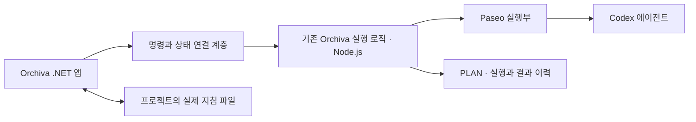

# Orchiva 데스크톱 전환 방향과 개발 인계

작성일: 2026-11-13 · Asia/Seoul

상태: 사용자 합의 방향 정리 완료. 데스크톱 상세 구현 계획과 구현은 미착수.

Orchiva의 다음 방향은 Windows .NET 앱에서 사용자의 게임 프로젝트를 선택하고, 분야와 요청 방식에 맞게 PLAN 기반 작업을 수행하는 것이다. 1차 전환에서는 기존 Orchiva 실행 로직과 Paseo를 연결한다. 이 문서는 다른 PC의 개발자나 에이전트가 대화 전체를 다시 읽지 않고 현재 소스와 합의한 방향을 이어받기 위한 기준이다. 문서 작성·GitHub 저장 요청은 데스크톱 구현 착수 지시와 구분한다.

## 현재 구현 기준

- 소스 원격: [kopite97/orchiva](https://github.com/kopite97/orchiva). 기준 브랜치는 main이다.
- 이번 문서 작업 전의 구현 기준: [7950654 — M6 구현·검증 완료](https://github.com/kopite97/orchiva/commit/7950654dc2e70909d86b8edc4d10403bce9c05d4).
- M0~M6는 [계획 목록](plans/README.md)에서 completed다. 현재 구현은 TypeScript·React Native 기반 Paseo Plugin과 Node.js 실행 로직이다.
- 현재 제품은 로컬 브라우저에서 사용하며, 등록된 PoC sandbox 하나와 단일 활성 TASK를 대상으로 한다. 아래에서 합의한 프로젝트 선택, 분야별 작업, 자유 질문, 지침 편집, .NET exe는 아직 구현하지 않았다. .NET 솔루션·프로젝트 파일도 아직 없다.
- [M6 결과](decisions/m6-acceptance.md)에 89개 자동 테스트, 통합 수용·장애·성능 측정과 사람 첫 사용 확인을 기록했다. 실제/모의 검증의 경계가 있으며 새 PC 설치·인증과 장기 운영까지 보장한 결과는 아니다. 이번 문서 작업에서 그 시험을 다시 수행한 것은 아니다.
- 기존 MVP 범위의 완료는 사용자가 최종적으로 원하는 게임 제작 도구 전체의 완료를 뜻하지 않는다.

## 사용자와 합의한 방향

| 항목 | 개발 기준 |
| --- | --- |
| 프로젝트 중심 | 새 요청 전에 사용자가 관리하는 게임 프로젝트를 선택한다. RNG는 예시이며 Orchiva 자체와 구분한다. 요청과 결과 이력도 프로젝트에 연결한다. |
| Windows 앱 | Windows에서 실행하는 .NET 데스크톱 앱을 만든다. 사용자 진입점은 exe다. |
| 1차 실행 구성 | .NET 앱에 기존 Orchiva 실행 로직과 Paseo 실행부를 연결한다. 현재의 Node.js 실행부를 즉시 전부 C#으로 재작성하거나 Paseo를 바로 제거하는 방향은 아니다. |
| 작업 분야 | 기획, 코딩, 아트, 사운드, 특수효과, 질문/상담을 구분한다. 이후 분야를 늘릴 수 있게 한다. |
| 요청 방식 | 제작 작업에는 새 요청과 수정 요청 선택을 제공한다. 선택한 방식에 따라 입력 양식이 달라진다. |
| 새 요청 입력 | 결과물 저장 경로, 분야에 맞는 규격화된 프롬프트, 에이전트 모델·수준을 사용한다. |
| 파일 이름 | 파일 이름 입력란은 두지 않는다. 여러 파일이 생성될 수 있으며 명명 규칙은 지침에서 정한다. |
| 질문/상담 | 자유 프롬프트 하나로 질문하고 이어서 대화할 수 있게 한다. 제작용 경로·검사 입력을 요구하지 않는다. |
| 프로젝트 폴더 | 프로젝트별 소스 폴더와 결과물 폴더를 구분한다. 프로젝트 루트가 소스 폴더와 같을 수 있다. |
| 작업 단위 | PLAN을 기준으로 작업한다. 요청마다 지침서를 만들지 않는다는 말은 PLAN을 없애라는 뜻이 아니다. |
| 산출물 | 결과물 폴더에는 요청한 산출물을 보관한다. 작업 후 요청하지 않은 새 지침서·README·작업 보고서를 관례적으로 만들지 않는다. 문서 자체가 요청한 산출물인 경우에는 생성한다. |
| 지침 원본 | 프로젝트의 지정된 경로에 있는 실제 파일을 원본으로 사용한다. 앱에서도 해당 파일을 조회·작성·수정할 수 있어야 한다. 읽기 전용으로 한정했던 초기 제안은 변경되었다. |
| 지침 확인 | 루트 AGENTS.md와 다른 지침 경로를 미리 등록하고, 공통 스크립트가 탐색·읽기·누락 확인을 수행하는 방향이다. 에이전트가 매번 필요한 파일을 스스로 찾아내는 데만 의존하지 않는다. |
| 검증 사용성 | 새 요청 화면의 완료 조건 추가, Node 검사 추가, 문자열 검사 추가 등 사용자가 검사를 직접 구성하는 부담을 제거한다. 자동 확인과 간단한 결과 검토로 대체할 구체적인 방식은 후속 설계에서 정한다. |
| 커스텀 지침 | 프로젝트와 분야에 따라 LLM 지침을 다르게 적용한다. 새 요청·수정 요청별 별도 커스텀도 수용할 수 있게 한다. |
| 세부 사항 | 사용자는 큰 방향을 먼저 정하고 세부 사항은 개발하면서 발전시키길 원한다. 아래의 제안·미정 항목을 이미 확정된 요구사항으로 바꾸어 해석하지 않는다. |

## 요청과 결과의 흐름

제작 작업의 기본 흐름은 프로젝트 선택 → 작업 분야 선택 → 새 요청 또는 수정 요청 → 요청 작성 → PLAN 확인 → 실행 → 결과 검토다. 경로와 모델의 기본값은 재사용할 수 있도록 설계하되, 구체적인 입력·선택 방식은 아직 정하지 않았다.

수정 요청에는 수정할 대상과 원하는 변경 내용이 필요하다. 기존 결과에서 진입하면 대상과 설정을 이어받고, 직접 진입하면 이전 결과 또는 소스의 파일·폴더를 선택하게 하는 방안을 제안했다. 유지해야 할 사항과 참고 자료를 선택 입력으로 받는 세부 양식은 후속 설계 대상이다. 제품의 수정 요청과 장애 복구를 위한 재전송·재개는 상태와 목적을 구분해야 한다.

질문/상담은 입력창 하나와 대화 이력을 중심으로 한다. 내부에서 간단한 PLAN을 구성하고 별도 확인 화면을 생략하는 방안을 제안했지만, 대화와 PLAN의 관계 및 모델 기본값을 확정한 것은 아니다. 질문 화면에 제작용 입력 양식을 다시 요구하지 않으면서 PLAN 기준 관리와 맞추는 설계가 필요하다.

생성·수정 결과는 별도 결과물 폴더에 보관하는 방향이다. 원본 소스에 반영하는 방법, 여러 파일의 경로 보존, 수정본의 버전·충돌 처리는 아직 정하지 않았다. 소스 폴더를 등록하는 것만으로 원본 덮어쓰기·Git 게시를 허용한 것으로 보지 않는다.

검증은 요청의 규격과 분야별 설정을 이용해 자동화하는 방향이다. 파일 존재·형식·크기와 같은 확인, 프로젝트에 설정한 빌드·테스트, 사람의 품질 판단을 구분한다. 실제 검사 결과와 LLM 검토 의견을 구분하고 미실행을 통과로 표시하지 않는 기존 원칙을 유지한다. 최종 완료 화면에서 줄일 입력과 예외 처리 방식은 후속 설계에서 정한다.

## 지침 파일과 목록

지침은 프로젝트의 실제 파일을 읽고 편집한다. Orchiva에는 경로와 적용 범위를 연결하며, 요청마다 결과물 폴더에 지침 복사본을 추가하지 않는다. 앱의 지침 편집과 에이전트의 산출물 생성은 서로 다른 동작이다.

진입 파일의 이름은 AGENTS.md다. 대화 중 AGETNS.md라는 표기도 있었지만 별도의 파일 규약을 뜻하지 않는다. 다른 지침의 위치와 적용 조건은 일관되게 읽을 수 있는 형식으로 등록하는 방안을 검토한다. 프로젝트 상대 경로, 하위 폴더 지침, 변경 감지, 적용 버전 고정은 상세 설계에서 구체화한다. 등록 형식이나 스크립트 파일명은 아직 확정하지 않았다.

다음은 새 게임에서 관리할 지침 항목의 초안이다. 각 행이 별도 파일이어야 하거나 프로젝트 시작 전에 모두 작성해야 한다는 요구사항은 아니다. 기존 문서 연결, 공통 규칙 재사용, 미정·해당 없음 처리를 지원하는 방향이다.

| 지침 항목 | 내용 예시 |
| --- | --- |
| 프로젝트 목표·범위 | 대상 사용자, 핵심 재미, 현재 목표와 제외할 기능 |
| 게임플레이 설계 원칙 | 핵심 플레이 반복 구조, 조작, 성장·보상·난이도 |
| 개발 환경·기술 제약 | 엔진·도구 버전, 플랫폼, 언어·패키지, 지원 기기 |
| 아키텍처 | 시스템 책임, 의존 관계, 데이터·저장 구조 |
| 코딩 규칙 | 명명, 오류·로그 처리, 라이브러리 사용 기준 |
| 세계관·공통 용어 | 설정, 등장인물·아이템 이름, 표현과 용어 |
| 아트 방향·제작 규격 | 화풍, 색상, 참고 자료, 해상도, 크기·좌표·출력 형식 |
| UI·사용성 | 화면·조작 일관성, 가독성, 언어, 접근성 |
| 사운드·음악 | 분위기, 파일 형식, 반복 재생·음량 기준 |
| 특수효과 | 표현 방향, 지속 시간, 정보 전달, 성능 제한 |
| 파일·결과물 관리 | 명명 규칙, 폴더 구성, 여러 파일 묶음, 수정본 보관 |
| 품질·검증 기준 | 목표 성능, 자동 확인 방법, 직접 확인할 품질 |

PLAN과 실행 이력에는 당시 적용한 지침을 식별할 수 있는 근거를 연결한다. 파일의 내용 해석과 실제 준수까지 단순한 경로 검사만으로 보장할 수는 없으므로, 객관적인 설정 검사와 에이전트 작업·결과 검증을 나누어 설계한다.

## 1차 데스크톱 구성

아래는 책임을 설명하는 논리적 구성이다. 프로세스 분할과 통신 방식은 아직 결정하지 않았다.



- .NET 앱은 프로젝트 선택, 지침 조회·편집, 요청 작성, PLAN 확인, 진행·결과 화면을 담당하는 방향이다.
- 기존 Orchiva 실행 로직과 Paseo는 작업 공간·세션 연결, 상태 추적, 중복 방지, 실패 복구의 검증된 출발점이다. 새 요구사항에 필요한 수정과 연결 검증은 별도로 수행한다.
- 연결 계층은 화면이 Paseo 세부 API에 직접 묶이지 않도록 두는 방향이다. 기존 저장소에 .NET과 Node.js가 동시에 임의로 쓰게 하지 않으며, 저장과 실행의 소유권은 상세 계획에서 정한다.
- 앱 실행 시 실행부의 시작·연결을 관리해 exe로 진입하는 사용 경험을 목표로 한다. 현재 수동 시작 스크립트가 곧 이 기능을 구현한 것은 아니다.
- C#·.NET 10 LTS·WinUI 3를 우선 후보로 제안했다. 사용자가 확정한 것은 .NET 앱과 기존 Paseo 실행부를 연결하는 1차 방향이다. 정확한 UI 프레임워크·SDK 버전·배포 형식은 구현 계획에서 결정한다.
- WPF는 검토 가능한 대안이며 Electron은 이전 후보였다. Paseo 제거와 Codex App Server 직접 연결은 1차 확정 범위가 아니다.

현재 UI·RPC는 Paseo Plugin에 의존한다. [클라이언트 진입점](../index.client.tsx), [서버 진입점](../index.server.ts), [실행 포트](../server/application/ports.ts), [Paseo 연결](../server/adapters/paseo/runtime.ts)을 함께 확인한다. 기존 코드를 무변경으로 새 UI에 연결할 수 있다고 가정하지 않는다.

## 상세 계획에서 결정할 사항

1. UI 프레임워크·SDK, 폴더 구성, 연결 프로토콜, 프로세스 시작·종료와 저장 소유권.
2. 프로젝트별 설정·요청·결과 분리 및 기존 v2 데이터의 호환·이관. 프로젝트가 여러 개여도 병렬 실행까지 허용한 것은 아니다.
3. 새 요청·수정 요청·질문과 PLAN의 관계, 각 양식과 LLM 커스텀 설정.
4. 지침 경로 등록 형식, 분야·경로별 적용, 편집 중 외부 변경과 실행 시 버전 처리.
5. 결과물 묶음·명명·수정본 관리 및 원본 프로젝트로 반영하는 방식.
6. 수동 검사 입력을 대체할 자동 검사와 최종 검토. 아트·사운드·특수효과의 실제 생성·미리보기 도구 연결은 아직 구현·검증하지 않았다.
7. exe 배포 시 Node.js·Paseo·Codex 설치와 인증, 새 PC 설치, 앱 종료 중 작업 유지·복원.

이 목록은 설계 질문이며 M7 같은 새 구현 단계의 등록이나 전체 구현 승인을 뜻하지 않는다. 세부 계획을 요청받으면 [계획 지침](plans/AGENTS.md)에 따라 작성하고 [계획 목록](plans/README.md)에 등록한다. 명시적으로 승인된 구현 범위 안에서는 같은 허가를 반복해서 묻지 않는다.

## 다른 PC에서 개발을 이어가는 절차

### 소스와 문서 가져오기

새 PC에서 저장소를 둘 상위 폴더를 선택하고 PowerShell에서 실행한다. GitHub 저장소 접근 권한과 Git이 필요하다.

```powershell
git clone https://github.com/kopite97/orchiva.git orchiva-plugin
Set-Location -LiteralPath .\orchiva-plugin
git status --short --branch
git log -1 --oneline
```

이미 checkout이 있다면 해당 소스 폴더에서 변경 사항을 먼저 확인한다. 로컬 변경이 없고 main에서 이어갈 때 다음 명령으로 받는다. 변경을 없애기 위해 reset·강제 checkout을 사용하지 않는다.

```powershell
git status --short --branch
git pull --ff-only origin main
```

처음 읽을 순서는 [루트 지침](../AGENTS.md) → 이 문서 → [기존 MVP 설계](mvp-design.md) → [계획 목록](plans/README.md) → [M6 결과](decisions/m6-acceptance.md)다. 다음 PC의 작업 폴더가 기존 PC의 절대 경로와 같을 필요는 없다. 저장소 이름은 orchiva이며 기존 기본 소스 폴더 이름은 orchiva-plugin이다.

### 기존 구현 확인과 실행 구분

현재 Node.js 소스를 확인하려면 package-lock.json을 유지하고 다음 명령을 소스 루트에서 사용한다. 필요한 Node.js 버전 등 기존 검증 환경은 [사용자 안내](user-guide.md)를 따른다.

```powershell
npm ci
npm run typecheck
npm test
```

이는 기존 TypeScript 구현의 확인 절차다. 아직 .NET 프로젝트가 없으므로 이 단계에서 dotnet build나 exe 실행을 기존 기능처럼 안내하지 않는다. .NET 개발 도구 설치와 프로젝트 생성은 후속 구현 계획에 포함한다.

실제 브라우저 MVP를 새 PC에서 실행하려면 별도 sandbox, Paseo·Codex 설치와 인증, Plugin 등록, 로컬 설정이 필요하다. Git clone만으로 기존 실행 환경과 과거 요청이 복원되지 않는다. 현재 [프로젝트 검사](../server/config/project-config.ts)는 사용자 홈의 lib/orchiva-PoC와 PoC-sandbox 원격을 제한하므로, 다른 게임 경로를 넣어서 우회하지 않는다. 자세한 현재 실행 절차는 [사용자 안내](user-guide.md)와 [문제 해결](troubleshooting.md)을 확인한다.

npm run verify 및 verify:lifecycle은 기존 PC의 PoC 요청·Worktree·daemon 데이터에 의존한다. 새 PC에서 그 데이터 없이 실패한 결과를 일반 코드 회귀 실패로 오해하지 않는다. 새 실연동 시험은 새 실행 식별자와 허용된 sandbox에서 준비한다.

### GitHub에 저장되는 것과 PC에 남는 것

| 대상 | 다른 PC에서의 취급 |
| --- | --- |
| Orchiva 소스·지침·설계·인계 문서·커밋 이력 | 이 GitHub 저장소에서 clone 또는 pull하여 이어간다. |
| 사용자가 관리할 게임의 소스와 실제 산출물 | 각 게임의 저장소나 별도 보관 경로에서 가져오고 로컬 경로를 연결한다. Orchiva 저장소에 자동 포함하지 않는다. |
| 현재 요청 JSON·PLAN 이력 | 사용자 홈의 .orchiva에 있는 로컬 데이터다. 이 저장소의 push 대상이 아니며, 이관은 별도 백업·호환 절차가 필요하다. |
| Paseo 세션·Worktree·진행 중 작업 | .paseo-orchiva 등의 로컬 실행 상태다. 문서 동기화만으로 다른 PC에서 실행을 이어받는 기능은 아직 없다. |
| 인증과 비밀값 | 새 PC에서 해당 도구의 인증 절차를 따른다. 인증 파일·.env·원본 요청 데이터 전체를 이 Git 저장소에 추가하지 않는다. |

이 요청에서 합의한 클라우드 저장은 GitHub를 통한 문서와 소스의 전달이다. Orchiva 제품에 클라우드 데이터 동기화·원격 실행·여러 PC의 동시 작업 기능을 추가한 것으로 해석하지 않는다.

현재 PC의 소스 위치는 C:/Users/USER/lib/orchiva-plugin, 실행 sandbox는 C:/Users/USER/lib/orchiva-PoC다. 두 저장소의 역할과 원격을 혼동하지 않는다. 실제 실행 원본과 증거는 보존하고, RNG 등 운영 프로젝트에서 시험하지 않는다.

## 다음 개발자에게 전달할 문장

> AGENTS.md와 docs/desktop-handoff.md를 먼저 읽고 현재 Git 상태 및 M0~M6의 구현 기준을 확인해 주세요. 다음 방향은 .NET 데스크톱 앱과 기존 Orchiva·Paseo 실행부의 연결입니다. 프로젝트별 기획·코딩·아트·사운드·특수효과·질문, 새 요청·수정 요청, 실제 지침 파일 편집, PLAN 기반 작업, 소스·결과물 분리를 반영해야 합니다. 확정 방향과 미정 세부 사항을 구분하고, 현재 요청한 범위에 맞춰 상세 계획 또는 구현을 이어가 주세요. 기존 증거와 사용자 변경을 보존하고 운영 게임 저장소를 시험 대상으로 사용하지 마세요.

## 관련 자료

- [현재 개발 절차](agents/workflow.md)와 [프로젝트 규칙](agents/repository-guidelines.md)
- [PoC 결과](poc-results.md), [현재 MVP 설계](mvp-design.md), [M6 수용 결과](decisions/m6-acceptance.md)
- 기술 후보 검토 자료: [WinUI 3](https://learn.microsoft.com/en-us/windows/apps/winui/winui3/), [.NET 지원 정책](https://dotnet.microsoft.com/en-us/platform/support/policy), [Codex App Server](https://learn.chatgpt.com/docs/app-server)
