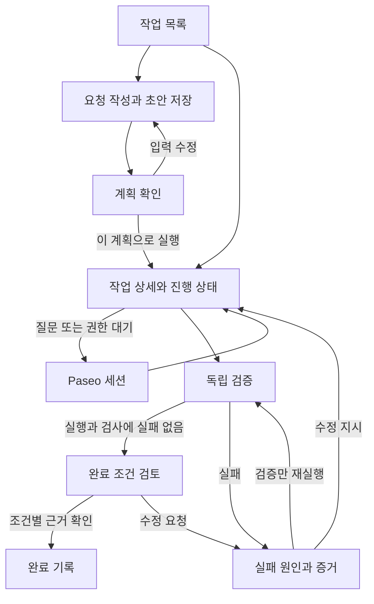
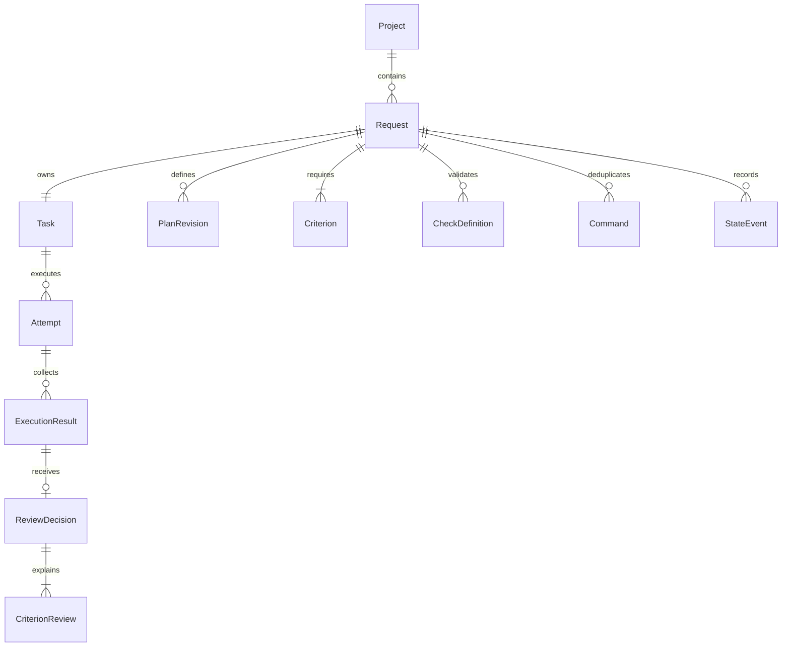

# Orchiva 프로토타입 MVP 설계

작성일: 2026년 11월 12일 · Asia/Seoul  
상태: M0~M6 구현·통합 수용을 완료한 로컬 프로토타입
대상: 제품 범위와 개발 순서를 결정하는 담당자 및 구현 개발자

개발 절차는 [지침 지도](../AGENTS.md), 단계별 실행 상태는 [계획 목록](plans/README.md)을 따른다. 첫 상세 계획은 [M0 실행 기반 확인](plans/m0-runtime-foundation.md)이다.

2026-11-12 현재 M0~M5를 구현했다. [M2 결과](decisions/m2-draft-plan-start.md)의 초안·계획 확인·고정 SHA 실행과 [M3 결과](decisions/m3-progress-reconciliation.md)의 독립 관측·진행/이력 화면·정상 재시작 복원을 검증했다. [M4 결과](decisions/m4-evidence-review.md)의 조건별 판정·과거 결과 상세·검사 변경 확인·명시적 파일 지문 비교도 구현·검증했다. [M5 결과](decisions/m5-recovery.md)의 초기 실패 재시도·확실한 전달 대조·같은 세션 재개·명령 중복 처리를 구현·검증했다. 강제 종료·장시간·성능 및 전체 수용 검증은 M6 범위다.

2026-11-13 [M6 결과](decisions/m6-acceptance.md)에 통합 수용, 저장·전송·프로세스 장애, 실제 RPC 성능, 30분 관측과 사용자 첫 사용 확인을 추가했다. 최초 실행의 부분 결과는 보존하고 보완 실행으로 완료했다. exe 배포·다중 사용자·원격 실행은 범위에 포함하지 않는다. 실제 질문/권한 요청의 재현은 미실행이며 해당 화면은 격리 fixture로 검증했다. 새 PC 설치 검증과 장기 운영 보장은 이 결과에서 주장하지 않는다.

## 목표와 설계 기준

첫 MVP는 사용자가 작은 개발 요청 하나를 등록하고, 실행할 계획을 확인한 뒤, Codex가 만든 결과를 근거와 함께 검토하여 완료하거나 같은 작업에서 수정을 이어가는 로컬 도구다. 핵심 흐름은 **요청 작성 → 계획 확인 → 단일 작업 실행 → 결과 검토 → 완료 또는 실패 재개**다.

[PoC 결과](poc-results.md)는 요청별 Worktree, Codex 실행 추적, 독립 검증, 명시적 완료 판정, 동일 세션 복구의 기능 타당성을 확인했다. 이 설계는 그 구조를 재사용하고, 실제 사용에 필요한 계획 확인, 화면 분리, 근거 연결, 백그라운드 상태 동기화와 복구 일관성을 추가한다. 아래 기능과 수용 기준은 MVP 개발 목표이며 PoC에서 이미 검증된 사실과 구분한다.

| 항목 | 첫 MVP의 선택 | 이유 |
| --- | --- | --- |
| 사용자와 환경 | Windows의 로컬 사용자 1명, Paseo daemon 1개, Plugin 인스턴스 1개 | 검증된 실행 환경을 유지한다. |
| 접속 방식 | localhost의 Paseo bundled web UI 안에서 Plugin 사용 | PoC에서 확인한 접속 경로를 사용한다. 호스팅 앱 연결 문제 해결은 별도다. |
| 프로젝트 | 현재 등록된 `orchiva-PoC` 저장소 1개 | 대상 경로와 remote 제한을 유지한다. 프로젝트 선택·추가는 후속 범위다. |
| 작업 단위 | 요청 1개에 TASK 1개, Worktree 1개, Codex 세션 최대 1개 | 실패 복구에서도 작업 정체성을 유지한다. |
| 실행 동시성 | 준비·실행·검증 중인 작업 최대 1개 | 스케줄러 없이 실행 충돌과 복구 판단을 단순화한다. 초안·완료 이력은 여러 개 보관한다. |
| 계획 | 입력 기반 템플릿과 사용자 확인 | 자동 작업 분해나 LLM 계획 생성은 넣지 않는다. |
| 저장 | 기존 요청별 JSON을 버전 2로 확장 | 기존 증거를 보존하면서 저장소 전환 부담을 줄인다. 다중 프로세스 쓰기는 지원하지 않는다. |
| 완료 책임 | 사용자가 완료 조건별 근거를 확인하고 최종 판정 | 에이전트의 성공 응답이나 테스트 통과만으로 완료하지 않는다. |
| 산출물 전달 | 결과·변경 파일·Worktree 위치를 제공 | 자동 commit, push, PR, merge, 배포는 포함하지 않는다. |

### 대표 사용 시나리오

사용자는 “음수를 포함해 두 수를 더하는 함수를 구현한다”는 요청과 완료 조건 두 개를 작성한다. 생성된 계획에서 작업 범위와 검사 파일을 확인하고 실행한다. 결과 화면에서 테스트 파일 검사 한 건에 포함된 두 테스트의 통과 로그와 변경 파일을 확인한다. 완료 조건마다 근거를 지정하고 완료를 확정한다.

검사가 실패하면 실패 원인과 로그를 보고 수정 지시를 입력한다. 같은 세션과 Worktree에서 다음 시도가 시작되며, 이전 결과와 판정은 이력에 남는다. 검증기 오류라면 코드 수정 없이 재검증할 수 있고, 사용자 질문이나 권한 요청이면 Paseo 세션으로 이동한다.

## 기능 범위

### MVP에 포함할 기능

| ID | 기능 | 사용자에게 제공할 동작 | PoC 대비 작업 |
| --- | --- | --- | --- |
| F01 | 환경 확인 | 저장소·기준 브랜치·daemon·Codex 실행 경로의 준비 상태와 해결 방법 표시 | 기존 설정 검증을 읽기 전용 사전 점검으로 노출 |
| F02 | 요청 초안 | 여섯 입력 영역, 초안 저장·재열기, 필수값 검증 | 즉시 실행 방식에서 저장과 실행 분리 |
| F03 | 완료 조건과 검사 | 완료 조건을 항목별로 작성하고 자동 검사 또는 수동 확인 방법 연결 | 자유문자열 조건을 구조화 |
| F04 | 계획 확인 | Request PLAN과 Task PLAN 미리보기, 입력 수정 후 재생성, 확인한 버전으로 실행 | 계획 확인 단계 추가 |
| F05 | 실행 준비 | 전용 Worktree와 세션 생성, 중복 시작 방지, 준비 단계 표시 | 기존 흐름 재사용 및 불확실한 생성 복구 강화 |
| F06 | 작업 목록과 상세 | 상태·다음 행동 중심 목록, 작업별 상세·결과·이력 화면 | 한 화면의 입력폼과 결과 카드를 분리 |
| F07 | 진행 추적 | 상태·마지막 확인 시각·연결 오류 표시, Paseo 세션 이동 | 화면 조회와 무관한 동기화 추가 |
| F08 | 결과 수집 | 응답·변경 파일·지문·검사 로그·실행 시간을 묶어 보존 | 결과 버전과 누락·잘림 표시 강화 |
| F09 | 결과 판정 | 완료 조건별 충족 여부·근거 입력, 완료 확정 또는 수정 요청 | 조건별 근거와 판정 이력 추가 |
| F10 | 실패 복구 | 오류 종류별 재시도·재검증·동일 세션 재개, 이전 결과 열람 | 복구 행동 분리 및 멱등성 강화 |
| F11 | 재시작 복원 | 저장된 작업과 외부 세션을 대조해 상태 복원 | Hook·조회 기반 보완에 시작 시 대조 추가 |

### 후속 버전으로 미룰 기능

다중 TASK와 의존성, 병렬 실행·대기열·예약, 자동 계획 생성과 대화형 계획 수정, 무인 자동 코드 수정, 다중 사용자·프로젝트·daemon, 원격 접속, 범용 shell 검증·의존성 설치·Unity 빌드, 자동 Git 게시와 배포, 알림 연동, 비용 정산은 제외한다. 사용자 요청에 따른 Worktree 삭제·자동 청소도 포함하지 않으며 결과는 로컬에 보존한다.

실행 중 질문·권한 승인·중단은 Paseo 세션에서 처리한다. MVP의 `Codex 세션 열기`는 해당 세션으로 이동하며, Orchiva 안에 별도의 채팅이나 권한 승인 UI를 만들지 않는다. 중단을 관측하면 자동 완료하지 않고 `failed`와 중단 사유를 기록한다.

### 입력과 계획 규칙

- Title, Goal, Scope, Constraints, Validation의 입력 영역을 유지하고 Completion Criteria는 1개 이상의 항목으로 받는다. Title 160자, 기존 장문 필드 12,000자 제한을 유지한다. 완료 조건은 최대 20개, 항목당 1,000자로 제한한다.
- 자동 검사는 기존 `node-test`, `file-contains` 두 종류를 최대 8개 등록한다. 파일은 Worktree 상대 경로만 허용한다. 임의 명령 입력은 제공하지 않는다.
- 각 완료 조건에는 연결할 검사 ID 또는 구체적인 수동 확인 방법이 최소 하나 있어야 한다. 검사 한 개를 여러 조건에 연결할 수 있다. 자동 검사 0건은 허용하되 결과 화면에 `자동 검증 없음 · 수동 검토 필요`를 표시한다.
- 초안 저장은 불완전한 입력도 허용한다. 계획 확인과 실행 직전에는 전체 입력을 검증한다. 입력·조건·검사가 바뀌면 계획 버전을 올리고 기존 계획 확인을 무효화한다.
- PLAN 자체를 자유 편집하지 않는다. 사용자가 입력을 고치면 두 PLAN을 함께 재생성한다. 완료 조건 목록도 PLAN에 포함한다.
- `이 계획으로 실행`은 현재 계획 버전 확인과 실행 요청을 한 번에 수행한다. 확인 전에는 Worktree나 Codex 세션을 만들지 않는다.
- 실행이 예약된 뒤 요청·계획·조건·검사 정의를 고정한다. 복구 지시는 기존 범위를 보완하는 용도로만 받는다. 목표나 완료 기준 변경은 내용을 복사한 새 요청으로 처리한다.

## 화면 흐름

화면은 작업 목록, 요청 작성, 계획 확인, 작업 상세의 네 종류다. 상세 화면 안에서 진행·결과·이력을 전환하므로 실패할 때 별도의 작업이나 페이지를 만들지 않는다. 아래 경로는 논리적 화면 ID이며, 실제 이동은 Plugin의 화면 구성에 맞춘다.

### 작업 목록

상단에 프로젝트 이름, 기준 브랜치, 연결 상태와 `새 요청`을 둔다. 실행 중 작업이 있으면 상단에 고정하고 현재 단계·경과 시간·다음 행동을 보여준다. 목록은 `전체`, `초안`, `진행 중`, `확인 필요`, `완료`로 필터링한다. `확인 필요`에는 질문 대기, 전송 확인 대기, 검토 대기, 실패를 포함한다.

각 행은 제목, 상태, 시도 번호, 마지막 갱신 시각과 한 개의 주요 행동을 표시한다. 첫 진입의 빈 상태는 `첫 요청 작성`, 조회 오류는 기존 목록을 유지한 채 `연결 재확인`을 제공한다. 목록은 최근 갱신 순으로 20개씩 조회하며 상세 로그는 불러오지 않는다.

### 요청 작성

본문에 목적·범위·제약, 완료 조건 목록, 검증 설정을 순서대로 배치한다. `초안 저장`과 `계획 확인`을 제공하며 저장 시각을 표시한다. 저장되지 않은 입력이 있는 상태에서 화면을 벗어날 때만 이탈 확인을 제공한다. 검증 오류는 해당 입력 근처에 표시하고 입력값을 보존한다.

완료 조건 행에는 조건 문장, 연결된 검사, 수동 확인 방법을 둔다. Node 검사 행에는 파일 경로와 설명, 문자열 검사 행에는 파일 경로·필수 문자열·설명을 둔다. 초안 작성은 다른 작업의 실행 중에도 가능하다.

### 계획 확인

상단에 목표와 범위, 중간에 두 PLAN의 미리보기, 하단에 완료 조건과 검사 요약을 보여준다. 대상 저장소·기준 커밋, 실행 환경 점검 결과와 자동 검사 유무를 함께 표시한다. 주요 행동은 `이 계획으로 실행`, 보조 행동은 `입력 수정`이다.

실행 중인 다른 작업이 있으면 버튼을 비활성화하고 해당 작업으로 이동할 수 있게 한다. 대기열에는 넣지 않는다. 서버도 실행 슬롯을 검사한다. 실행 응답이 끊겨도 동일 작업 ID와 명령 키로 상태를 확인하며 새 요청을 만들지 않는다.

### 작업 상세

상단에는 제목, 상태, 시도 번호, 마지막 관측 시각, 주요 행동을 둔다. 탭은 `진행`, `결과`, `이력`이다. Worktree 경로·세션 ID·계획 원문은 펼쳐 보는 세부 정보로 둔다.

| 표시 상태 | 기본 내용 | 주요 행동 |
| --- | --- | --- |
| 실행 준비 중 | Worktree 준비, 계획 기록, 세션 생성의 단계별 결과 | 상태 확인 |
| 실행 중 | 실행 시작·경과 시간, 마지막 관측, 최근 상태 이벤트 | Codex 세션 열기 |
| 사용자 확인 필요 | 질문·권한 대기 사유 | Codex 세션 열기 |
| 전달 확인 중 | 실행 또는 재개 요청의 전달 여부와 마지막 확인 오류 | 전달 상태 확인 |
| 검증 중 | 실행 중인 검사, 완료 수, 검증 시작 시각 | 결과 보기 |
| 검토 대기 | 완료 조건, 검사 결과, 변경 파일, 최종 응답 | 조건별 근거 검토 |
| 실패 | 오류 종류, 원인, 해당 결과·로그, 가능한 복구 | 오류별 재시도 또는 재개 |
| 완료 | 판정 시각·근거와 승인된 결과 버전 | 결과와 Worktree 확인 |

결과 탭은 `완료 조건 → 자동 검사 요약 → 변경 파일 → 최종 응답 → 상세 로그` 순서다. `검사 1/1 통과`는 검사 파일 단위임을 명시하고, 파일 안의 테스트 개수는 로그로 보여준다. 미추적 파일도 목록에 표시하며 diff 요약이 비어 있다고 변경이 없다고 표시하지 않는다. 출력 잘림과 수집 한도 초과는 구분한다.

검토자는 각 조건을 `충족` 또는 `미충족`으로 표시하고 검사·파일 참조 또는 수동 확인 근거를 남긴다. 모든 조건 충족, 조건별 근거, 최종 판정 메모가 있어야 `완료 확정`을 활성화한다. `수정 요청`에는 구체적인 수정 사유가 필요하고 즉시 실행하지 않는다. 사유가 채워진 재개 입력을 보여주고 사용자가 `같은 작업에서 재개`를 눌렀을 때 다음 시도를 시작한다.

### 실패와 연결 문제의 복구

| 분류 | 화면 설명 | 허용할 행동 |
| --- | --- | --- |
| `setup` | 실행 파일·설정·Worktree 준비 실패 | 원인 해결 후 초기 실행 재시도. 이미 생성된 리소스를 우선 재사용 |
| `execution` | Codex 실행 오류 또는 중단 | 세션이 존재하고 멈췄음을 확인한 뒤 수정 지시로 재개 |
| `validation` | assertion 실패 또는 필수 문자열 누락 | 로그를 확인하고 수정 지시로 재개 |
| `verification-system` | 검사 실행기·증거 수집 오류 또는 검증 제한 초과 | 환경을 확인한 뒤 재검증. 실패를 통과로 바꾸지 않음 |
| `review-rejected` | 사용자가 완료 조건 미충족으로 판정 | 수정 사유를 보완해 재개 |
| `delivery-unknown` | 세션 생성·재개 전달 결과가 불확실함 | 외부 리소스와 대조. 확인 전 자동 재전송과 새 실행 금지 |
| 연결 끊김 | 현재 상태를 관측할 수 없음 | 마지막 상태 유지, 관측 시각과 오류 표시. 자동 실패·완료 처리 금지 |
| 세션 또는 Worktree 유실 | 기존 작업을 안전하게 이어갈 리소스가 없음 | 원인과 기존 증거 표시, 내용을 복사해 새 요청 작성 |

## 상태와 실행 규칙

### 저장 상태와 전이

기존 세부 준비 상태를 유지하고 앞에 `draft`, `ready`를 추가한다. `ready`는 계획 미리보기와 입력 검증이 끝난 상태이며 실행 승인을 뜻하지 않는다. 실행 명령을 수락하면 확인한 계획 버전과 기준 커밋을 고정하고 기존 `planned` 단계로 들어간다.

| 현재 상태 | 사건과 조건 | 다음 상태 |
| --- | --- | --- |
| `draft` | 유효한 입력으로 계획 생성 | `ready` |
| `ready` | 입력 변경 | `draft`, 이전 계획 확인 무효화 |
| `ready` | 현재 버전으로 실행, 환경 점검 통과, 실행 슬롯 확보 | `planned` |
| `planned` | 준비 진행 | `creating-worktree` → `writing-plan` → `starting-session` → `started` |
| 준비 단계 | 확정된 준비 실패 | `failed`, 오류 종류 `setup` |
| `started` | 실제 실행 관측 | `running` |
| `running` | 질문·권한 대기 | `needs-input`, 사유 `permission` 또는 `question` |
| 준비 또는 재개 단계 | 명령 전달 결과 불확실 | `needs-input`, 사유 `delivery-unknown` |
| `needs-input` | 외부 확인과 대조 완료 | 확인된 단계에 따라 `running`, `validating`, `failed` |
| `running` | 실행 종료 또는 중단 관측 | `validating`에서 종료 원인과 증거 수집 |
| `validating` | 실행 실패 없고, 등록된 검사 전부 통과, 증거 수집 완료 | `awaiting-review` |
| `validating` | 실행·검사·증거 수집 실패 | `failed` |
| `awaiting-review` | 조건별 검토와 최신 결과 확인 통과 | `completed` |
| `awaiting-review` | 수정 요청 | `failed`, 오류 종류 `review-rejected` |
| `failed` | 세션 생성 전의 확정된 실패 재시도 | 마지막 확인된 준비 단계부터 진행 |
| `failed` | 멈춘 기존 세션에서 명시적 재개 | 시도 번호 증가 후 `running`, 불확실하면 `needs-input` |
| `failed` 또는 `awaiting-review` | 검증 재실행, 세션이 멈춰 있고 슬롯 확보 | 같은 시도에서 `validating`, 새 결과 버전 생성 |

완료 결과는 이력으로 고정한다. 완료 후 외부에서 파일이나 세션을 바꾸더라도 이전 판정은 삭제하지 않는다. 상세 조회 때 변경을 감지하면 `완료 당시 결과와 현재 작업 상태가 다름`을 표시한다. 완료한 작업을 다시 실행하는 기능은 MVP에서 제공하지 않고 새 요청 작성으로 연결한다.

### 동시성 및 중복 방지

1. 프로젝트 실행 슬롯은 Worktree 준비·실행·사용자 입력 대기·검증과 전달 불확실 상태에서 점유한다. 에이전트가 멈추고 검증이 종료된 `awaiting-review`, `completed`, 확정된 `failed`에서는 해제한다. 재개와 재검증도 슬롯을 확보해야 한다.
2. 프로젝트 단위 잠금 안에서 슬롯 확인과 작업의 실행 의도 저장을 수행한다. 요청별 잠금은 상태 변경·결과 수집·판정에 사용한다. 잠금 순서는 항상 프로젝트 → 요청으로 통일한다.
3. 모든 변경 명령은 `commandKey`와 입력 해시를 저장한다. 같은 키·같은 입력의 재호출은 기존 명령 결과를 반환하고, 같은 키·다른 입력은 `IDEMPOTENCY_CONFLICT`로 거부한다. 오래된 시작·복구 키도 요청 이력 안에 보관한다.
4. Worktree 생성, 세션 생성, 재개 전송 전에 명령과 상관 식별자를 영속화한다. 응답 유실 시 저장된 식별자로 외부 리소스를 조회한다. 조회로 부재를 확정하거나 공급자가 중복 제거를 보장할 때만 재전송한다. 그 기능이 없으면 확인 필요 상태로 남긴다.
5. 서버 시작 때 비종료 작업과 pending 명령을 먼저 대조한 뒤 새 실행을 허용한다. 작업 두 개가 실행 중으로 발견되면 새 실행을 차단하고 사용자에게 기존 세션을 확인하도록 안내한다.
6. 같은 저장 디렉터리를 쓰는 두 번째 Plugin 인스턴스는 시작 시 거부한다. 프로세스 잠금은 종료·재시작 시 소유 프로세스와 시작 식별자를 확인해 회수하며 시간 경과만으로 살아 있는 소유자의 잠금을 제거하지 않는다.

### 관측과 검증

Hook은 빠른 상태 갱신에 사용하고, daemon 내 단일 백그라운드 루프가 비종료 작업을 5초 간격으로 대조한다. 화면은 표시 중인 상세를 2초 간격으로 조회하지만 조회 자체가 테스트를 다시 실행하지 않는다. 브라우저를 닫아도 daemon이 살아 있으면 관측과 결과 수집이 계속된다. daemon이 꺼져 있는 동안은 갱신되지 않으며 재시작 때 복원한다.

M3의 주기 대상은 실행 슬롯 점유 요청과 결과 없는 실행 요청이다. 안정된 검토 대기·확정 실패·완료는 반복 수집하지 않는다. 외부 세션 변화는 Hook 또는 명시적 상태 확인으로 관측한다. 미착수 accepted와 알려진 Worktree의 PLAN 기록은 이어갈 수 있으며, 외부 생성 응답이 불확실한 checkpoint는 unknown으로 보존한다. M5는 확정 준비 실패의 재시도와 검증 가능한 found만 적용하는 명시적 대조 UI를 제공한다. 연결 소유·재접속·종료와 실제/모의 검증 경계는 [M3 결과](decisions/m3-progress-reconciliation.md)를 따른다.

관측 실패는 마지막 확정 상태와 분리해 저장한다. 연속 실패 시 5초, 10초, 20초, 최대 30초 간격으로 재조회한다. 15초 이상 성공한 관측이 없으면 연결 지연을 표시한다. 재조회는 새 Codex 실행이나 코드 수정 재시도를 발생시키지 않는다.

관측 시각만 갱신된 경우에는 명령의 충돌 검사에 쓰는 `revision`을 올리지 않는다. 상태·입력·결과가 실제로 바뀌면 올린다. 검토 중 새 결과가 생기면 작성 중인 메모는 유지하되 조건 확인을 초기화하고 새 결과를 검토하도록 안내한다.

실행 종료의 `sourceKey`를 기준으로 결과 수집 중복을 제거한다. 같은 실행에 대한 일반 조회는 저장 결과를 반환하고, `검증 다시 실행`만 새 검증 회차를 만든다. Hook과 루프가 동시에 들어와도 하나만 수집한다. 검증 도중 재시작되면 세션이 멈췄는지 확인한 후 미완료 검증을 재수행한다.

Node 검사당 10초, 검증 루프 예산 20초, 파일당 2 MiB, 최대 300개 파일, 검사 로그 마지막 16,000자와 응답 마지막 32,000자의 기존 한도를 유지한다. 시작하지 못한 검사는 `skipped`와 사유를 남기며 전체 통과로 계산하지 않는다. 증거 수집 제한 초과는 검토 가능 결과로 넘기지 않는다. 이 시간은 Git·통신을 포함한 전체 응답 시간 보장이 아니다.

검증기의 파일 쓰기와 자식 프로세스 차단을 유지한다. 이 실행 방식은 임의의 악성 코드에 대한 완전한 격리나 네트워크 차단을 보장하지 않으므로 첫 버전은 신뢰하는 로컬 sandbox 작업을 대상으로 한다.

## 데이터 모델

M1에서 v2 저장과 이력을 구현했다. 현재 파일은 기존 평면 상태·최신 결과 필드를 호환 뷰로 유지하고 `results`, `decisions`, `attemptHistory`, `commands`를 보존한다. 아래 엔티티 표는 MVP 최종 목표이며 상세 파일 증거·조건별 판정·새 화면 계약까지 모두 구현됐다는 뜻은 아니다. 실제 필드 매핑과 마이그레이션 근거는 [M1 결과](decisions/m1-storage-state.md)를 따른다.

논리적으로 요청, 작업, 시도, 결과, 판정을 분리하되, 저장은 요청별 JSON 하나를 원자적으로 교체하는 방식을 유지한다. 요청과 작업은 항상 1:1이므로 별도 TASK 저장소를 만들지 않는다. 프로젝트 설정만 별도 파일로 관리한다. 상태와 증거를 다른 파일에 나눠 저장하면서 생기는 다중 파일 트랜잭션은 첫 버전에서 피한다.

위 관계도는 실행 가능한 요청 기준이다. 미완성 초안은 완료 조건이 없어도 저장할 수 있다.

### 주요 엔티티

| 엔티티 | 주요 필드 | 보존 규칙 |
| --- | --- | --- |
| `ProjectConfig` | `projectId`, `name`, `repositoryPath`, `remote`, `baseRef`, `provider`, `maxActiveTasks: 1` | 실행 당시 설정을 요청에 스냅샷으로 저장한다. |
| `Request` | `schemaVersion: 2`, `id`, `token`, `revision`, `createdAt`, `updatedAt`, `feature`, `criteria[]`, `checks[]`, `plans[]`, `confirmedPlanRevision`, `projectSnapshot` | `revision`은 저장 충돌 검사용이며 `planRevision`과 독립적으로 증가한다. |
| `Criterion` | `id`, `text`, `checkIds[]`, `manualMethod` | 실행 확정 뒤 조건 ID를 바꾸지 않는다. 기존 자유문장을 여러 조건으로 임의 분할하지 않는다. |
| `CheckDefinition` | `id`, `kind`, `path`, `label`, `text?` | 실행 시작 시 정의를 고정한다. 실제 검사 파일 내용의 해시는 결과에 따로 저장한다. |
| `PlanRevision` | `revision`, `inputHash`, `requestPlan`, `taskPlan`, `baseCommit`, `createdAt` | 사용자가 확인한 입력·계획·기준 커밋의 일치를 실행 조건으로 삼는다. |
| `Task` | `id`, `status`, `statusReason`, `failure`, `workspaceId`, `worktreePath`, `agentId`, `attemptNumber`, `latestResultId`, `observation`, `pendingCommandKey` | 실패에는 `kind`, `code`, `message`, `retryAction`을 둔다. 연결 오류는 `observation`에 분리한다. |
| `Attempt` | `id`, `number`, `trigger`, `instruction`, `startedAt`, `endedAt`, `turnId`, `outcome`, `resultIds[]` | 최초 실행은 1이다. 같은 세션에 새 수정 지시를 전달할 때 증가한다. 재조회·재검증에서는 증가하지 않는다. |
| `ExecutionResult` | `id`, `attemptId`, `validationRun`, `sourceKey`, `collectedAt`, `finalResponse`, `files[]`, `fingerprint`, `checks[]`, `executionFailure`, `collectionFailure`, `truncation` | 수집이 끝난 결과는 불변이다. 재검증할 때도 이전 결과를 삭제하지 않는다. |
| `FileEvidence` | `path`, `changeType`, `sha256`, `size`, `deleted`, `isCheckInput` | 변경·미추적 파일과 명시한 검사 입력을 식별한다. 삭제 파일은 삭제 사실을 저장한다. |
| `CheckResult` | `checkId`, `status`, `exitCode`, `output`, `durationMs`, `failureKind`, `inputFingerprint` | `status`는 `passed`, `failed`, `error`, `skipped`다. 프로세스 종료 코드와 오류 분류를 구분한다. |
| `ReviewDecision` | `id`, `resultId`, `approved`, `note`, `reviewedAt`, `criteriaReviews[]`, `testChangesAcknowledged`, `testChangeNote` | 결과 ID에 연결된 불변 기록이다. 수정 요청 판정도 보존하고 재개 시 삭제하지 않는다. |
| `CriterionReview` | `criterionId`, `satisfied`, `evidenceRefs[]`, `note` | 참조는 같은 결과의 검사 ID·파일 경로다. 수동 확인에는 구체적인 `note`가 필요하다. M4는 최소 10자를 요구하며 자동 검사 0건에서는 모든 조건에 수동 근거를 요구한다. |
| `Command` | `key`, `kind`, `payloadHash`, `status`, `phase`, `messageId`, `resourceIds`, `outcomeRef`, `createdAt`, `resolvedAt` | `pending`, `applied`, `failed`, `unknown`을 기록한다. 응답 재전송에 필요한 원래 결과 참조를 보존한다. |
| `StateEvent` | `at`, `from`, `to`, `reason`, `attemptId`, `commandKey` | 표시용 최근 100건과 생략 건수를 저장한다. 결과·판정·명령 이력에는 이 제한을 적용하지 않는다. |

### 완료 판정의 불변 조건

1. 상태는 `awaiting-review`이고 판정 대상은 최신의 수집 완료된 결과 ID여야 한다.
2. 실행·증거 수집 실패가 없으며 등록한 검사가 모두 통과해야 한다. 검사 0건은 이 조건만 만족하며 수동 확인을 생략할 수 없다.
3. 모든 완료 조건에 충족 판정과 근거가 있어야 한다. 검사와 연결되어 있다는 이유만으로 조건을 충족 처리하지 않는다.
4. 외부 세션이 멈춰 있고 `sourceKey`가 대상 결과와 일치해야 한다. 전달이 미확정인 명령이 없어야 한다.
5. 판정 직전에 파일 지문을 다시 수집하여 대상 결과의 지문과 비교한다. 다르면 이전 결과를 보존한 채 `재검증 필요`를 표시하고 판정을 거부한다.
6. 판정은 결과 ID·지문·근거를 함께 보존한다. 여러 탭에서 들어오는 오래된 판정은 `STALE_RESULT` 또는 `REVISION_CONFLICT`로 거부한다.

지문은 기존 HEAD·변경·미추적 파일을 기본으로 삼고 등록한 검사 파일도 명시적으로 포함한다. ignored 파일을 산출물로 취급하는 기능은 MVP에서 지원하지 않는다. 검사 대상이 ignored라면 계획 확인 시 거부하고, 실행 후 무시 대상이 된 경우에도 검증 오류로 처리한다. 판정은 확인 당시 결과를 기록하며 외부 편집기의 동시 쓰기까지 원자적으로 고정하는 보장은 아니다.

검사 파일의 최초 수집 해시를 기준으로 저장하고 복구 후 결과에도 실제 해시를 기록한다. 해시가 달라지면 `검사 파일이 변경되었습니다`를 표시하고, 검사 변경 확인과 사유가 추가되기 전에는 완료를 확정할 수 없다. 완료 후 현재 파일 비교는 명시적 읽기 전용 작업이며 기존 결과와 판정을 변경하지 않는다. 과거 파일 해시가 없으면 비교 불가로 안내한다. 파일이 같다면 PoC처럼 원래 검사를 유지한 복구였음을 설명할 수 있다. 에이전트가 작성한 검사 자체의 정확성은 수동 검토 대상이다.

### 저장과 마이그레이션

- `%USERPROFILE%\.orchiva\requests\<token>.json` 구조를 유지한다. 스키마 검증, 임시 파일 쓰기, rename 교체를 거쳐 저장한다. 저장 중 남은 임시 파일을 정식 요청으로 읽지 않는다.
- 버전 없는 PoC 기록을 v1으로 취급하고 마이그레이션 전 원본을 별도 backup 디렉터리에 보관한다. 변환이 성공한 요청만 교체한다. 실패한 파일은 개별 진단 대상으로 분리하여 다른 요청 목록까지 실패시키지 않는다.
- 기존 요청·TASK·세션·Worktree ID, 시도 번호, 결과 ID와 판정 근거를 유지한다. 기존 `attempts[]`와 최신 결과를 새 시도·결과 배열로 옮긴다. 이미 사라진 과거 재검증 결과나 수정 요청 판정은 복원했다고 표시하지 않는다.
- 기존 `completionCriteria`는 단일 `legacy` 조건으로 옮긴다. 기존 완료 판정은 `legacy: true`로 표시하고 조건별 검토를 수행했다고 간주하지 않는다. 마이그레이션만으로 완료 기록을 미완료로 돌리지 않는다.
- 실행을 시작한 기존 기록에 계획 확인 단계를 소급하여 요구하지 않는다. 확인의 출처를 `legacy-execution`으로 표시한다. 초기 검증 2건의 `awaiting-review`도 유지한다.
- 알 수 없는 미래 버전은 덮어쓰지 않고 파일과 오류를 표시한다. MVP 기간에는 결과·판정을 자동 삭제하지 않으며 보관 건수·총크기를 진단에서 보여준다.

## 애플리케이션 구성과 RPC

현재 UI, 애플리케이션, 도메인, 외부 어댑터의 분리를 유지한다. 상태 전이와 판정 조건은 서버에서 강제한다. 화면은 서버가 반환하는 `allowedActions`로 가능한 행동을 표시한다.

| 위치 | 변경할 책임 |
| --- | --- |
| `client/screens` | 목록, 초안, 계획 확인, 상세의 네 화면으로 분리 |
| `client/components` | 조건 편집, 검사 설정, 진행 표시, 결과 검토, 시도 이력 |
| `shared/contracts` | v2 스키마, 목록 요약, 상세 응답, 변경 명령, 오류 코드 |
| `server/domain` | 입력 기반 계획 생성, 상태 전이, 허용 행동과 불변 조건 |
| `server/application` | 초안 저장, 계획 생성, 시작, 관측, 검증, 판정, 복구 유스케이스 |
| `server/adapters/paseo` | Worktree·세션 생성과 대조, 관측, 메시지 전달 |
| `server/adapters/storage` | v2 저장과 마이그레이션, 프로세스 점유, 파일 증거와 검증기 |
| `server/application/reconcile` | 시작 시 복원, 단일 백그라운드 루프, 종료 시 정리 |

다음은 목표 계약이며 모든 필드가 구현된 것은 아니다. M2는 `project.preflight`, `request.save-draft`, `request.prepare-plan`, 확인 입력의 `request.start`, token 조회의 `request.get`을 제공한다. M3는 `request.page`의 요약·필터·20건 cursor, `request.detail`의 요청과 allowedActions, `runtime.status`의 운영 진단을 추가했다. 기존 list/get은 호환 계약을 유지하고 resultId별 상세 선택은 후속 단계다. 시작은 의도와 슬롯을 저장한 `planned` 접수 후 반환하며 독립 worker가 이어간다. SDK 이름 제약에 맞춰 RPC에는 소문자와 하이픈을 쓴다. 변경 명령에는 `commandKey`를 붙이고 입력 편집·실행·판정에는 적절한 `expectedRevision`도 전달한다. 같은 명령의 재전송 판정은 revision 충돌 검사보다 먼저 한다.

| RPC | 주요 입력 | 응답과 부수 효과 |
| --- | --- | --- |
| `project.read` | 없음 | 기존 설정과 대상 표시 |
| `project.preflight` | 없음 | 환경 점검 결과. 세션을 만들거나 전역 설정을 바꾸지 않음 |
| `request.save-draft` | `token`, `feature`, `criteria`, `checks`, `expectedRevision` | 초안 저장. 실행을 시작한 요청은 거부 |
| `request.prepare-plan` | `token`, `expectedRevision` | 입력 검증, 계획 생성, 기준 커밋 확인 후 `ready`로 전환 |
| `request.start` | `token`, `planRevision`, `inputHash`, `expectedRevision` | 계획 확인과 실행 의도를 저장하고 준비 시작. 무거운 처리를 RPC 연결 유지에 의존시키지 않음 |
| `request.retry-start` | `token`, `commandKey`, `expectedRevision`, `targetCommandKey` | M5: 마지막 확정 초기 실패만 안전한 단계부터 재시도. 고정 PLAN·리소스·외부 생성 키 유지 |
| `request.reconcile` | `token`, `commandKey`, `expectedRevision`, `targetCommandKey` | M5: unknown 명령 대조 이력 추가. 확실한 found만 연결, 나머지는 unknown·슬롯 유지 |
| `request.page` | `filter`, `cursor`, `limit` | M3: 최대20건 요약과 다음 커서·진행 중 고정 목록. 기존 list는 전체 반환 유지 |
| `request.detail` | `token` | 현재 요청·실패 설명·허용 행동. 과거 결과는 반환된 results에서 선택 |
| `runtime.status` | 없음 | M3: 독립 연결·복원 상태·마지막 성공·다음 시도·오류 |
| `request.refresh` | `token` | 외부 상태 재대조. 기존 결과의 검사를 무조건 다시 실행하지 않음 |
| `request.revalidate` | `token`, `commandKey`, `resultId`, `expectedRevision` | 멈춘 세션인지 확인하고 같은 시도에 새 검증 회차 생성. 수집 실패로 결과가 없으면 resultId null |
| `request.review` | `token`, `resultId`, `approved`, `criteriaReviews`, `note`, `expectedRevision`, 검사 변경 확인 | 결과의 최신 여부와 근거를 검사하고 판정 저장 |
| `request.resume` | `token`, `key`, `instruction`, `resultId`, `expectedRevision` | M5: 신규 명령은 현재 결과·revision·리소스·멈춘 세션 확인 후 시도와 전달 의도를 저장하고 기존 세션에 전송. 기존 명령 재호출은 이전 형식 호환 |

계획 표시 후 기준 브랜치의 커밋이 바뀌면 `PLAN_STALE`로 재확인을 요구한다. M0에서 SHA 기반 생성을 실증했고 M2는 저장한 SHA를 사용하여 생성 후 HEAD도 대조한다. `BUSY`는 실행 중인 요청 ID를, `ENVIRONMENT_NOT_READY`는 해결 가능한 진단 항목을 반환한다. 목표 오류 계약은 이외에 `INVALID_STATE`, `DELIVERY_UNKNOWN`, `RESOURCE_MISSING`을 구분한다.

PoC의 기존 `request.start`가 입력과 동시에 실행하는 방식은 새 UI에서 사용하지 않는다. 기존 기록에 대한 동일 입력 재호출은 참조를 반환하는 호환 경로를 유지하되 새 요청이 계획 확인을 우회하도록 허용하지 않는다. 기존 `verify` 스크립트에도 이 차이를 반영한다.

### 실행 기반 확인 결과와 후속 의존 사항

SDK의 `PluginServerContext`에는 초기화 시 사용할 `paseo` 속성이 없다. M0에서 `createHostClient`와 `createPaseoApi`를 소유하는 독립 연결을 구현하고, 화면·최초 RPC 없는 Plugin 초기화 관측과 종료를 확인했다. M0 시험 모드는 기본 비활성이다. M3는 소유 연결 위에 운영 중 재접속·요청 대조를 구현했으며 초기 store 준비가 끝나면 자동 시작한다. 기존 list RPC를 주기 호출하거나 콜백 컨텍스트를 무기한 보관하지 않는다.

M0 실제 연동에서 workspace·agent의 동일 `idempotencyKey` 재호출은 응답 유실·daemon 재시작 후 같은 ID로 수렴했다. 고정 SHA의 Worktree 생성과 생성 후 HEAD 대조도 확인했다. 반면 provider에서 복원된 메시지는 `clientMessageId`가 소실될 수 있다. 페이지 조회를 추가했으며 식별자가 없는 이력·관측 실패는 `unknown`으로 다룬다. 현재 PoC에서는 pending 복구를 `needs-input`에 보존하고 자동 재전송·새 키의 재개를 차단한다. M5는 `delivery-unknown` 설명과 명시적 대조를 제공하며 부재·식별자 소실을 강제 해소하지 않는다. 새 Agent에 요청 label을 기록하고 경로·PLAN·HEAD를 대조한다. 선택적 failure·deliveryChecks·recovery.previousSourceKey를 저장하며 대조 이력은 불변이다. failure의 retryAction은 별도 저장하지 않고 allowedActions로 계산한다.

M0에서 초기 미승인 2건의 최신 결과가 목록 조회로 재수집됐다. M1은 현재 존재하는 4건을 원본 백업 후 변환하고 불변 결과·판정 이력을 도입했으며, 목록 조회의 외부 수집을 제거했다. M3는 조회·관측·명시적 재검증을 분리하고 기존6건의 바이트 보존을 확인했다. M0에서 이미 소실된 envelope는 복원하지 못했으며 보존 한계는 [M0 결과](decisions/m0-runtime-foundation.md)를 참조한다.

## 개발 순서

담당자 한 명이 순서대로 구현하는 기준으로 각 단계를 작동 여부를 확인할 수 있는 단위로 나눈다. 기간 산정은 첫 SDK 연결·복구 확인 후에 수행한다.

| 단계 | 구현 내용 | 주요 대상 | 완료 조건 |
| --- | --- | --- | --- |
| M0 실행 기반 확인 | 브라우저 없는 Paseo 연결, 생성·전송 대조, 기준 커밋 지정, Plugin 종료 처리 검증 | Paseo 어댑터, 검증 스크립트 | 시작 직후 관측과 응답 유실 처리를 실증하고 사용할 API 경로 확정 |
| M1 저장과 상태 모델 | v2 스키마, 마이그레이션, 결과·판정 불변 이력, 명령 이력, 프로세스 점유와 실행 슬롯 | contracts, storage, domain | 기존 4건을 보존해 옮기고, 동시 시작 두 건 중 하나만 실행 |
| M2 요청과 계획 확인 | 초안 저장, 조건·검사 편집, 계획 미리보기, 확인 후 시작 | 초안·계획 화면, 계획 생성, start | 저장·재조회·입력 변경·재확인이 작동하며 미확인 계획으로 Worktree 생성 불가 |
| M3 진행과 복원 | 목록·상세 진행 표시, Hook과 백그라운드 대조, 연결 상태, 시작 시 복원 | 상세 화면, reconcile, RPC | 브라우저를 닫아도 검증으로 진행하고 재시작 후 ID·슬롯·상태 복원 |
| M4 결과와 판정 | 조건별 근거, 검증 오류 분류, 과거 결과 표시, 지문 확인, 검사 파일 변경 표시 | evidence, review, 결과 탭 | 근거 없음·오래된 결과·검사 실패에서는 완료 불가, 정상 결과는 명시적 완료 가능 |
| M5 실패와 재개 | 초기 재시도, 검증만 재실행, 동일 세션 복구, 명령 중복 제거 | resume, 재시도 처리, 이력 탭 | 실패→수정→완료를 같은 세션에서 수행하며 모든 결과와 판정 보존 |
| M6 통합 수용 검증 | 초기 환경 절차, 회귀·장애 시험, 소요 시간 측정, 사용 안내 | scripts, tests, docs | 아래 수용 표를 통과하고 실측값과 남은 제약 기록 |

M1부터 기존 타입 검사와 12개 테스트를 기준으로 회귀 확인을 수행한다. 사양이 바뀐 기대값은 변경 이유와 함께 갱신한다. M2에서는 요청부터 실행까지, M4에서는 성공한 전체 흐름, M5에서는 실패 복구까지 시연할 수 있어야 한다. 시각적 다듬기는 M3 이후 정보 구조와 상태별 행동이 갖춰진 뒤 진행한다.

## 수용 기준

### 필수 시나리오

| ID | 시나리오와 기대 결과 | 확인 방법 |
| --- | --- | --- |
| A01 | 초안 저장 후 화면을 다시 열면 입력·조건·검사가 복원됨 | GUI |
| A02 | 계획 확인 전 세션 없음. 입력 변경 시 이전 계획 실행 불가, 재확인 후 실행 가능 | 계약 테스트와 GUI |
| A03 | 두 요청을 동시에 시작하면 하나만 실행하고 다른 요청에는 `BUSY` 반환. 같은 시작 키 재전송은 같은 ID 반환 | 동시 호출 테스트와 실제 연동 |
| A04 | sum 성공 예에서 검사 파일 1건과 내부 테스트 2개를 구분하고 근거 입력 후에만 완료 가능 | 실제 연동과 GUI |
| A05 | increment의 의도적 실패를 보존하고, 원래 검사 파일을 바꾸지 않은 채 같은 세션·Worktree의 시도 2에서 성공 | 실제 연동, 해시·ID 비교 |
| A06 | 자동 검사 0건이면 검토 대기로 진행하고 모든 조건의 수동 근거 없이는 완료 불가 | GUI와 서버 거부 테스트 |
| A07 | 수정 요청 판정을 보존하고 명시적으로 재개한 뒤 다음 시도로 진행 | GUI와 이력 비교 |
| A08 | 검증 후 파일·세션 변경 시 오래된 결과 판정 거부. 재검증 후에도 이전 결과 보존 | 애플리케이션 테스트와 실제 연동 |
| A09 | 검증기 오류·예산 초과·미실행 검사를 구분하고 검증만 재실행할 때 시도 번호 유지 | 검증기·애플리케이션 테스트 |
| A10 | 브라우저를 닫아도 검증·검토 대기까지 진행하고 재접속 후 결과 조회 가능 | 실제 연동 |
| A11 | daemon 정상 재시작 후 기존 ID·시도·결과·판정·복구 키 유지 | 기존 verify와 새 통합 검증 |
| A12 | 전송 직후 응답 유실, 저장 전후 강제 종료에서 세션·수정 지시가 중복 생성되지 않음. 확인 불가 시 확인 대기 | 경계별 장애 주입과 대표 사례 실제 연동 |
| A13 | 연결 끊김을 실행 실패로 오판하지 않고 복귀 후 대조. Paseo에서 중단하면 사유를 보존하고 복구 가능 | 장애 주입과 실제 세션 중단 |
| A14 | 기존 4건, 손상 파일 1건, 미지원 버전을 처리하며 정상 요청과 기존 증거 보존 | 마이그레이션 테스트와 원본 비교 |
| A15 | 두 번째 Plugin 시작을 거부하고 종료 후 재시작 가능. 미확정 작업이 있으면 새 실행 차단 | 프로세스·재시작 시험 |
| A16 | 완료 후 변경으로 이전 판정을 지우지 않고 현재 상태와의 차이를 표시. 복구 중 검사 파일 변경도 표시 | 파일 변경과 이력 비교 |

### 응답 시간과 운영 확인

다음은 PoC 실측 결과가 아니라 같은 PC의 로컬 환경에서 측정할 MVP 목표값이다.

| 지표 | 목표와 측정 조건 |
| --- | --- |
| 초안 저장·목록·상세 조회 | 저장된 요청 100건, 30회 측정에서 p95 1초 이내. 외부 실행 시간과 큰 로그 추가 조회 제외 |
| 시작·재개 명령 접수 응답 | 30회 측정에서 p95 2초 이내. 실행 의도를 저장한 접수까지 측정하며 Codex 시작 완료와 구분 |
| 정상 연결 시 상태 반영 | 관측 가능해진 뒤 10초 이내 저장 상태에 반영. 검증 중에는 `validating`이 보여야 함 |
| daemon 재시작 후 복원 | 연결 성립 후 30초 이내 복원하거나 구체적인 확인 대기 이유 표시 |
| 사용자 복구 | 새 세션을 만들지 않고 실패 사례를 복구하며 화면에서 다음 행동을 찾을 수 있음 |

요청마다 접수·실행 시작·종료·검증 시작·종료 시각과 시도 수를 기록한다. 모델 실행 시간이나 비용을 보장값으로 삼지 않으며 비용 표시는 데이터 취득 가능성을 확인한 후 추가한다.

장시간 관측 시험은 외부 변경이 없는 통제된 작업으로 30분간 수행하며, 중복 검증·타이머 누적·상태 유실 여부를 확인한다. 이는 장시간 운영 전체의 신뢰성 보증이 아니라 프로토타입의 기본 동작 확인이다.

MVP 완료 조건은 M0의 연동 의존 사항을 해소하고 A01~A16을 통과하며 응답 시간의 실측과 제약을 기록한 뒤, 첫 사용자가 성공·실패 복구 양쪽을 화면에서 완료할 수 있는 것이다. 목표 응답 시간을 넘으면 원인과 보완 결과를 확인하거나 목표 변경 근거를 설계에 반영한다. 중복 실행이나 실패 증거 유실을 알려진 제약으로 남긴 채 완료 처리하지 않는다.

## 후속 설계 판단과 참조

JSON에서 DB로의 전환은 다중 프로세스, 검색 규모, 저장 지연이 문제가 될 때 재검토한다. 프로젝트 추가는 대상 등록과 허용 범위, 범용 검증은 실행 격리와 산출물 범위, 무인 복구는 중단 조건과 재시도 상한을 설계한 뒤 도입한다. MVP 개발에 필요한 제품 선택은 위 범위로 두고 M0에서 확인한 실행 기반과 제약을 후속 단계에 적용한다.

- [PoC 결과 보고서](poc-results.md): 검증된 범위, 제약, MVP 설계 입력.
- [상세 검증 기록](verification.md): 성공·실패·복구·재시작의 증거.
- [현재 계약](../shared/contracts/feature-request.ts): 상태, 요청, 결과, RPC의 출발점.
- [현재 실행 관리](../server/application/track-execution.ts): 관측, 결과 수집, 판정, 복구.
- [현재 시작 처리](../server/application/start-feature-request.ts): Worktree와 세션 생성.
- [Paseo 어댑터](../server/adapters/paseo/runtime.ts): 멱등 키, 이력 관측, 재개 메시지.
- [현재 검증기](../server/adapters/storage/evidence.ts): 지문, 독립 검사, 수집 제한.
